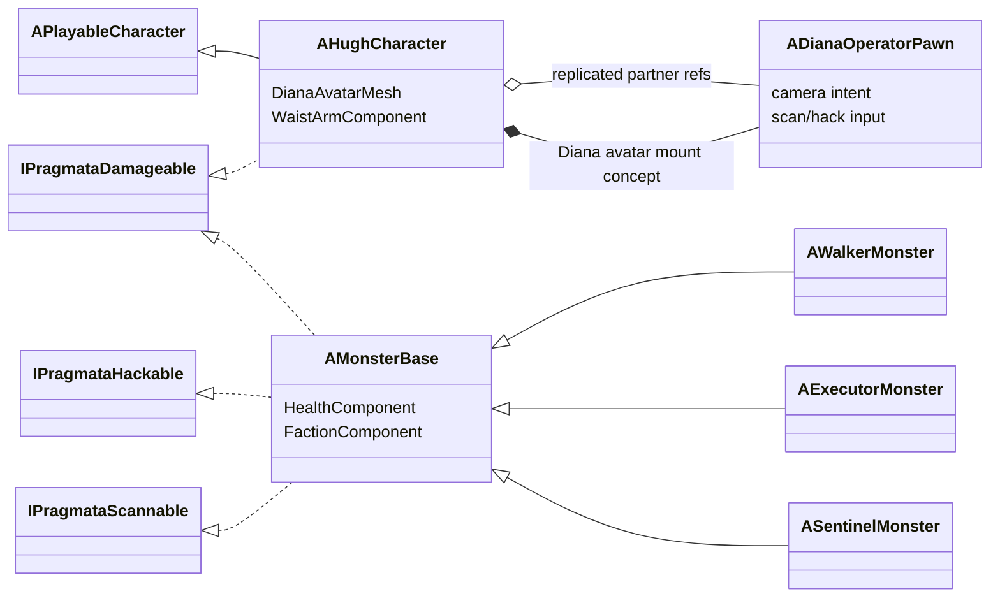
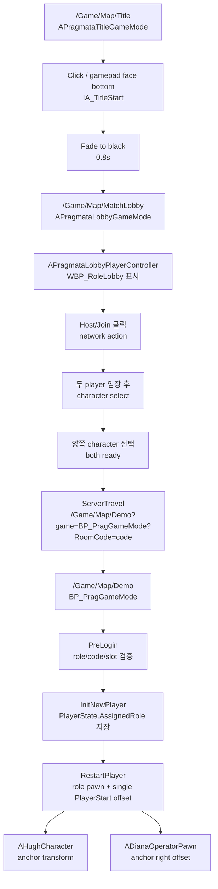
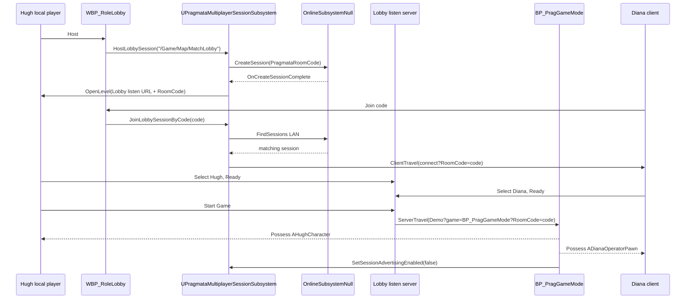
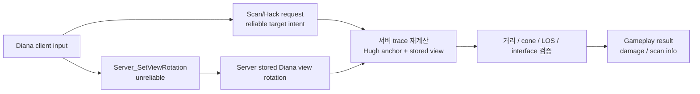

# Architecture

## Server Reference

서버/listen server/role replication 세부 계약은 `Docs/Systems/Server/server.md` 기준.
이 문서는 전체 구조와 asset/AnimBP 경계를 함께 기록하고, 서버 문서는 다음 내용을 집중 관리.

- Host/Join network action과 Hugh/Diana gameplay role 분리
- lobby selection, `PreferredRole` 하위 호환, `LobbySelectedRole`, `AssignedRole`, `ActiveControlRole`
- lobby handoff와 gameplay spawn 권한 경계
- Hugh movement prediction과 replicated animation display state
- listen server/client 네 가지 조합 검증 matrix

## Hugh-Diana-Monster Vertical Slice

### 결정

- `Hugh`는 실제 이동과 전투를 담당하는 `AHughCharacter`
- `Diana` 플레이어는 몸을 possess하지 않는 `ADianaOperatorPawn`
- Diana 모델은 `AHughCharacter` 내부 `DianaAvatarMesh`
- Monster는 `APlayableCharacter`와 분리된 `AMonsterBase`
- 공통 생명/피해/대상 판정은 상속보다 component/interface 중심

### 클래스 축

```text
APlayableCharacter : ACharacter
└─ AHughCharacter

ADianaOperatorPawn : APawn

AMonsterBase : ACharacter
├─ AWalkerMonster
├─ AExecutorMonster
└─ ASentinelMonster
```



- `APlayableCharacter`: 물리적으로 조작 가능한 플레이어 캐릭터 기반
- `AHughCharacter`: Hugh 본체, Diana avatar mesh, pair animation 소유
- `ADianaOperatorPawn`: Diana 클라이언트 입력 장치, camera/scan/hack만 처리
- `AMonsterBase`: damage/hack/scan 대상이 되는 적 기반
- `AWalkerMonster`: 첫 vertical slice 적 leaf
- `AExecutorMonster`: Executor scan 표시와 mesh/AnimBP 연결을 가진 적 leaf
- `ASentinelMonster`: Sentinel scan 표시와 8x8 enemy hack type을 가진 boss enemy leaf

### 공통 기능

- `UPragmataHealthComponent`
  - `MaxHealth`, `CurrentHealth`, `bIsDead`
  - server-authoritative damage/heal
  - health/death delegate 제공
- `UPragmataFactionComponent`
  - `Neutral`, `Player`, `Monster` 진영
  - 진영 적대 판정 제공
- `IPragmataDamageable`
  - 서로 다른 base를 가진 Hugh/Monster 피해 처리 계약
  - function name은 `CanReceiveDamage`, `ReceiveDamage`처럼 receiver 관점 사용
- `IPragmataHackable`
  - Monster, 기계, 문, 퍼즐 장치 확장용 hack 계약
- `IPragmataScannable`
  - Monster, item, 환경 단서 확장용 scan 계약

### Diana 구조

- Diana 플레이어는 `ADianaOperatorPawn`만 possess
- Diana 모델은 Hugh mesh의 `DianaMountSocket`에 attach
- `DianaMountSocket`이 없으면 Hugh mesh root에 fallback attach
- Diana avatar mesh는 collision/off, movement/off, possession 없음
- camera 이동은 Diana local input
- scan/hack은 server RPC 요청 후 서버 검증

검증 조건:

- Diana action lock 상태 아님
- Hugh reference 존재
- camera origin이 Hugh 기준 허용 거리 내
- target distance 유효
- target이 Hugh 전방 cone 안에 있음
- line of sight 유효
- target이 필요한 interface 구현

기본값:

- Hugh 전방 cone: `±105도`
- Diana hack damage: `UDianaHackComponent`의 `BaseHackDamage + HackDamagePerUpgrade * HackDamageUpgradeLevel`
- Diana 전용 stat component 없음

#### WaistArm attachment 보정

결정:

- 기존 Blueprint binding 유지: `BP_HughCharacter > WaistArmComponent > WaistArmMesh`
- `UWaistArmComponent`가 `WaistArmMesh` 생성과 animation state 전달 담당
- `AHughCharacter::AttachWaistArm()`은 `WaistArmComponent`만 Hugh mesh socket에 attach
- `WaistArmMesh`는 `WaistArmComponent`의 child로 유지

원인:

- `WaistArmMesh`를 Hugh mesh에 직접 reparent하면 기존 component hierarchy가 깨짐
- `WaistArmMesh`를 actor-owned component로 완전 분리하면 기존 BP override가 새 component path로 자동 이관되지 않음
- 이 경우 PIE에서 `No SkeletalMesh for Component(WaistArmMesh)` 경고와 waist-arm invisible 발생
- `Template Mismatch`는 instance `WaistArmMesh`가 template `WaistArmComponent`를 parent로 참조할 때 발생

수정 방식:

- `PreRegisterAllComponents()`에서 `WaistArmMesh`의 attach parent를 instance `WaistArmComponent`로 보정
- `EnsureWaistArmMeshAttachment()`는 registration 전 `SetupAttachment(this)`만 수행
- weapon attach와 Diana IK socket lookup은 계속 `WaistArmMesh` 기준 사용
- 완전 분리는 장기 refactor 후보이나 BP asset override migration 없이는 적용 금지

#### Diana Mount Socket / IK 구조

IK 의미:

- `IK`: animation 재생 후 손/발 끝 위치를 특정 target에 맞추는 보정
- 목적: 800개 이상 animation을 직접 수정하지 않고 socket 위치에 손/발 고정
- 권장 위치: Diana mount AnimBP 또는 Control Rig

socket 소유 구분:

- `DianaMountSocket_root`
  - Diana mesh 전체 attach 기준
  - 조회 대상: Hugh 본체 `Mesh`
  - 위치 기준: `BP_HughCharacter` viewport에서 `WaistArmMesh`의 left/right paddle 사이 중심
- `DianaMountSocket_LeftPaddle_Front`, `DianaMountSocket_RightPaddle_Front`
  - middle toe IK target
  - 조회 대상: `BP_HughCharacter > WaistArmComponent > WaistArmMesh`
  - socket 소유 asset: `/Game/Character/Hugh_WaistArm/SK_Hugh_WaistArm`
- `DianaMountSocket_LeftPaddle_Back`, `DianaMountSocket_RightPaddle_Back`
  - 예약된 foot/ankle 보조 IK target
  - 조회 대상: `BP_HughCharacter > WaistArmComponent > WaistArmMesh`
  - socket 소유 asset: `/Game/Character/Hugh_WaistArm/SK_Hugh_WaistArm`
  - 현재 runtime IK에서는 계산/적용하지 않음
- `DianaMountSocket_LeftHandle`, `DianaMountSocket_RightHandle`
  - 기본 손 IK target
  - 조회 대상: `BP_HughCharacter > Mesh`
  - socket 소유 asset: `/Game/Character/Hugh/SK_Hugh`
- `DianaMountSocket_LeftSideHandle`, `DianaMountSocket_RightSideHandle`
  - side handle 손 IK target
  - 조회 대상: `BP_HughCharacter > Mesh`
  - socket 소유 asset: `/Game/Character/Hugh/SK_Hugh`
  - animation별 target 선택용

bone/socket 대응:

- `L_FootMiddleF1`: `DianaMountSocket_LeftPaddle_Front`
- `R_FootMiddleF1`: `DianaMountSocket_RightPaddle_Front`
- `L_Foot`: `DianaMountSocket_LeftPaddle_Back` 예약
- `R_Foot`: `DianaMountSocket_RightPaddle_Back` 예약
- `L_Palm`: `DianaMountSocket_LeftHandle` 또는 `DianaMountSocket_LeftSideHandle`
- `R_Palm`: `DianaMountSocket_RightHandle` 또는 `DianaMountSocket_RightSideHandle`

bone chain:

- 왼발: `Hip -> L_Thigh -> L_Shin -> L_Foot -> L-Toe -> L_FootMiddleF1`
- 오른발: `Hip -> R_Thigh -> R_Shin -> R_Foot -> R-Toe -> R_FootMiddleF1`
- 왼손: `Hip -> Spine_0 -> Spine_1 -> Spine_2 -> L_Shoulder -> L_UpperArm -> L_Forearm -> L_Hand -> L_Palm`
- 오른손: `Hip -> Spine_0 -> Spine_1 -> Spine_2 -> R_Shoulder -> R_UpperArm -> R_Forearm -> R_Hand -> R_Palm`

원칙:

- mesh attach는 `DianaMountSocket_root` 하나만 사용
- 발 paddle socket은 `WaistArmMesh`에서 읽어 AnimBP 또는 Control Rig IK target으로 사용
- 손 handle socket은 Hugh 본체 `Mesh`에서 읽어 AnimBP 또는 Control Rig IK target으로 사용
- socket 이름만 맞고 조회 component가 틀리면 IK target이 없거나 원점으로 튀는 문제 발생
- Diana IK는 target socket world transform을 Diana mesh component space로 변환해서 사용
- 발 IK target은 항상 paddle 고정, Diana는 middle toe 기준으로 paddle 위에 섬
- 무릎은 정면으로만 접히도록 Two Bone IK joint target 또는 IK Rig pole/hinge 방향 지정
- 손 grip pose는 animation 기준 사용, palm 위치만 handle/side handle에 보정
- 손 IK target은 `UDianaAnimInstance` state 계산으로 handle/side handle 선택
- 손이 handle과 side handle 사이를 이동하는 구간은 target 전환 blend 또는 손 IK alpha 일시 감소
- 급격한 Hugh 움직임에서는 손 alpha 또는 arm extension 보정으로 Diana 몸통 안정성 유지

AnimBP target transform 전달:

- `UDianaAnimInstance::UpdateIKTargets()`가 toe와 hand IK target을 C++에서 계산
- 현재 적용 target은 toe와 hand이며, foot/Paddle_Back 경로는 보존만 함
- IK 변수는 `UDianaAnimInstance` native `UPROPERTY`로 소유하고 `ABP_Diana` AnimGraph가 읽음
- AnimGraph FABRIK 노드는 `ABP_Diana`에 유지
- `ABP_Diana` EventGraph의 기존 IK socket 계산은 제거하고 native update 값을 사용
- Diana mount AnimInstance C++에서 `Get Owning Actor`로 Hugh actor 획득
- Hugh에서 `WaistArmComponent > WaistArmMesh`를 얻어 paddle socket을 확인
- handle과 side handle은 Hugh 본체 `Mesh`에서 socket을 확인
- target component의 socket world location을 읽음
- 현재 AnimBP가 붙은 Diana mesh component transform으로 world location을 component space로 변환
- `FABRIK` 사용 시 `Effector Transform Space = Component Space`
- 회전까지 맞출 때는 `Inverse Transform Rotation`으로 socket world rotation도 Diana component space로 변환
- socket 미존재 시 native IK alpha property를 `0.0`으로 낮춤

C++ IK 구조:

- 소유 클래스는 `UDianaAnimInstance`
- 매 frame `NativeUpdateAnimation()`에서 상태 갱신 후 `UpdateHandIKTargetMode()`, `UpdateIKTargets()` 순서로 호출
- `CacheHughCharacter()`는 `GetOwningActor()`를 `AHughCharacter`로 캐시하고 Hugh movement component도 같이 보관
- `UpdateHandIKTargetMode()`는 Diana 상태를 손 target mode로 변환
  - legacy `CombatIndependent`: `Handle`. 현재 runtime layer는 선택하지 않음
  - `FollowHugh` + `MountIdle` 또는 `Idle`: `Handle`
  - 그 외 follow 상태: `SideHandle`
  - Hugh 참조 없음: `None`
- `UpdateIKTargets()`는 target socket을 읽어 native IK property를 채움
  - toe target은 `HughCharacter > WaistArmComponent > WaistArmMesh`에서 읽음
  - hand/side hand target은 `HughCharacter > Mesh`에서 읽음
  - `_Back` paddle socket은 `LeftFootIKSocketName`, `RightFootIKSocketName`으로 보존하지만 현재 update에서는 호출하지 않음
  - `bDeathActive`가 true면 `ResetIKTargets()` 후 즉시 반환해 모든 IK alpha를 `0.0`으로 유지
- `ResetIKTargets()`는 IK alpha 값을 `0.0`으로 초기화
- `UpdateSocketIKTarget()`은 공통 변환 helper
  - target component, Diana mesh, socket 이름, socket 존재 여부를 확인
  - socket world location을 가져옴
  - Diana mesh component transform 기준으로 component-space location으로 변환
  - 성공 시 location과 alpha `1.0`을 output reference에 씀
  - 실패 시 alpha만 `0.0`으로 둠

Native IK property:

- location property
  - `LeftToeIKLocation`, `RightToeIKLocation`
  - `LeftFootIKLocation`, `RightFootIKLocation`
  - `LeftHandIKLocation`, `RightHandIKLocation`
- alpha property
  - `LeftToeIKAlpha`, `RightToeIKAlpha`
  - `LeftFootIKAlpha`, `RightFootIKAlpha`
  - `LeftHandIKAlpha`, `RightHandIKAlpha`
- socket setting property
  - `LeftToeIKSocketName`, `RightToeIKSocketName`
  - `LeftFootIKSocketName`, `RightFootIKSocketName`
  - `LeftHandIKSocketName`, `RightHandIKSocketName`
  - `LeftSideHandIKSocketName`, `RightSideHandIKSocketName`

`ABP_Diana` 경계:

- EventGraph는 IK 계산을 하지 않음
- EventGraph 실행 노드는 제거
- `ABP_Diana` asset-owned member variable은 두지 않음
- AnimGraph는 native `UDianaAnimInstance` property를 읽어 FABRIK effector location과 alpha에 연결
- FABRIK 노드는 Blueprint에 남김
- active FABRIK chain은 toe, hand, side hand 위치를 적용
- foot/Paddle_Back FABRIK 경로와 native 변수는 예약 상태
- active FABRIK alpha pin은 native alpha property get을 사용
- socket 미존재 시 `UDianaAnimInstance`가 해당 alpha를 `0.0`으로 낮춤
- `_0` suffix가 붙은 Blueprint duplicate variable은 금지
- native C++ variable getter가 `FloatProperty` 단정밀도 pin으로 생성되어야 함

상태별 IK alpha:

- 기본 탑승/대기: 양발 `1.0`, 왼손 `1.0`, 오른손 `1.0`
- 이동/일반 회전: 양발 `1.0`, 왼손 `1.0`, 오른손 `1.0`
- handle 고정 animation: 양발 `1.0`, 손 alpha `1.0`, 손 target `Handle`
- side handle 고정 animation: 양발 `1.0`, 손 alpha `1.0`, 손 target `SideHandle`
- attack/hack/door interaction 중 손이 손잡이를 놓는 animation: 해당 손 alpha `0.0`
- 강한 hit react: 필요 시 손 alpha 일시 감소
- 사망: 양발/양손/예약 foot alpha 모두 `0.0`, death animation 원본 pose를 IK가 덮지 않음

작업 순서 이유:

- 먼저 `DianaMountSocket_root`를 맞춰 Diana 전체 위치 기준을 고정
- 다음에 기본 탑승 pose 1개를 준비해 pelvis, 무릎, 팔꿈치 방향을 안정화
- 이후 발 IK만 켜서 paddle target 조회와 component-space 변환을 검증
- 발이 안정된 뒤 손 IK를 handle, side handle 순서로 확장
- 마지막에 animation별 손 target metadata 또는 DataAsset 값을 추가

### Damage Flow

- 자세한 damage contract는 `Docs/Systems/Damage/damage-flow.md`에 둔다.
- type/class 이름은 `FPragmataDamageSpec`, `IPragmataDamageable`, `UPragmataHealthComponent`처럼 `Pragmata` prefix 유지
- damage function 이름은 caller `Deal*`, receiver `Receive*` 기준
- `IPragmataDamageSource`는 runtime 공격 owner의 현재 damage 제공
- weapon damage: `AWeaponBase::DealDamageToHitActor` -> `UPragmataDamageLibrary::DealDamageToActor` -> `IPragmataDamageable::ReceiveDamage`
- GripGun fire는 `AHughCharacter::Server_RequestFire`가 서버로 넘긴 뒤 `AGripGun::PullTrigger` authority gate와 `CommitServerShot`에서 ammo/trace/damage를 확정
- GripGun reload gameplay clock은 서버 montage 완료 callback이 `OnCompleteReload`를 호출하는 시점이며, client presentation은 ammo/reload state를 직접 바꾸지 않음
- GripGun impact VFX는 서버 trace 결과를 multicast로 표시하며 damage 판정과 분리
- melee damage: `UAnimNotifyState_AttackHitWindow`가 server socket sweep 후 `DealDamageToActor` 호출
- impact overlap damage: `UAnimNotify_AttackHitOverlap`이 owner의 `IPragmataDamageSource` 값을 조회한 뒤 `DealDamageToActor` 호출
- `DealDamageToActor`는 source/target 양쪽에 faction component가 있으면 적 진영에게만 damage 전달
- final health 변경: `UPragmataHealthComponent::ReceiveDamage`
- `AMonsterBase`는 `bHacked == false`일 때 최종 damage를 `0.1`배로 줄임
- Unreal damage API는 gameplay damage 경로로 쓰지 않고 source가 `FPragmataDamageSpec`을 직접 생성

### Paired Animation

- Hugh damage는 `IPragmataDamageable::ReceiveDamage`로 진입
- Hugh damage 성공 시 Hugh가 HitReact montage를 직접 재생
- `Large`, `Death`, `ForcedPair` 피격만 `UPairedAnimationComponent`가 pair cue 생성
- `FPairedAnimationCue`는 `SequenceId`, cue type, strength, direction, server start time 포함
- `UPairedAnimationSet` DataAsset은 강제 동기화 montage cue와 Diana directional death montage를 제공
- Diana montage는 hard hit, shelter, death처럼 Diana 행동을 끊어야 하는 cue에서만 재생
- Death cue에서 Diana는 별도 damage/collision 판정 없이 Hugh가 계산한 `FPairedAnimationCue.Direction`으로 `DA_PairedAnimationSet`의 directional death montage를 선택
- 같은 hitreact 반복도 `SequenceId` 증가로 재생 가능
- Diana scan/hack 잠금도 강제 동기화 cue에서만 적용
- small/medium Hugh hit react는 Diana combat animation과 scan/hack을 끊지 않음

### Diana Animation Blueprint

결정:

- Diana avatar mesh AnimBP: `/Game/Blueprints/Player/ABP_Diana`
- C++ parent class: `UDianaAnimInstance`
- 기본 pose driver: `UDianaAnimInstance` 변수 + `ABP_Diana` State Machine
- 강제 paired event driver: `UPairedAnimationComponent` + `DA_PairedAnimationSet` + montage Slot
- directional death driver: `UPairedAnimationComponent`가 Hugh death cue direction으로 `DA_PairedAnimationSet` death montage entry를 선택
- follow pair 전용 DataAsset 없음

이유:

- Hugh의 이동/점프/호버 상태를 Diana가 따라야 하므로 state 판정은 C++에서 Hugh를 직접 읽음
- AnimBP는 pose graph와 animation asset 배치만 담당
- ordinary follow animation은 긴 상태라 State Machine에 적합
- hard hit, shelter, Diana death는 짧은 interrupt event라 Montage에 적합
- death는 Hugh의 directional damage 결과를 그대로 따라야 하므로 Diana 쪽에서 방향을 다시 계산하지 않음
- `UDianaFollowAnimationSet`은 runtime driver가 아니면 검증표 역할만 남으므로 v1에서 제외
- paired montage asset hard load를 C++에 넣지 않고 AnimBP/DataAsset에 유지
- Diana death montage는 `DA_PairedAnimationSet` hard reference로 cook chain에 포함

#### Hugh/Diana Locomotion BlendSpace 축 동기화

Diana follow locomotion은 `FollowState`가 walk/jog/run animation을 직접 고르는 구조가 아니다.
`UDianaAnimInstance`가 Hugh의 `MovementSpeed`를 읽고, `ABP_Diana > Locomotion` 상태의 `BS_Diana_Mount_Locomotion_1D`가 그 속도값으로 pose를 고른다.

따라서 Hugh locomotion BlendSpace의 속도 축이 바뀌면 Diana BlendSpace도 같은 축으로 갱신해야 한다.
현재 기준은 다음과 같다.

- `0`: idle
- `150`: walk
- `300`: jog
- `600`: boost

merge 후 Hugh는 `BS_HughLocomotion_1D`에서 `600` 속도에 boost animation을 재생한다.
Diana BlendSpace가 `600`에 jog를 두면 Hugh가 boost 중이어도 Diana는 jog pose만 재생한다.
그래서 Diana가 Hugh animation을 따라가지 않는 것처럼 보인다.

`FollowState`는 jump, land, hover, death 같은 top-level state transition 판단에 사용한다.
일반 locomotion 안의 idle/walk/jog/boost 선택은 `MovementSpeed`와 BlendSpace sample axis가 담당한다.

현재 구조:

- `UDianaAnimInstance::UpdateLayerMode()`와 `UpdateCombatState()`는 `APragmataGameState::GetDianaOperatorPawn()`으로 Diana operator mode를 읽음
- `TActorIterator<ADianaOperatorPawn>` 조회는 GameState pointer가 비어 있는 초기화/PIE fallback이며 주 runtime 경로가 아님

우선순위:

```text
ForcedPair > FollowHugh
```

- `ForcedPair`
  - `APragmataGameState::bDianaActionsLocked == true`
  - 또는 Diana operator mode가 `HitReactLocked`, `MountedWatch`
  - hard hit, death, forced pair 같은 강제 동기화 montage가 현재 Diana 동작보다 우선
- `FollowHugh`
  - 기본 locomotion 상태. Diana operator mode가 `Combat`이어도 유지
  - enemy combat은 HUD와 Diana 입력·스킬 허용만 바꾸며 tense idle을 선택하지 않음
  - Hugh `MovementState`, falling, hover 값을 Diana follow enum으로 변환

현재 `ABP_Diana` 상태:

- skeleton: `SK_Diana`
- state machine 이름: `Main State Machine`
- transition 구조: Hugh식 top-level state 배치
- state count: 8
- transition count: 10
- 상태: `Locomotion`, `Combat`, `Jump_Start`, `Jump_Loop`, `Jump_End`, `Death`, `Hover_Start`, `Hover_Loop`
- `Locomotion`: `BS_Diana_Mount_Locomotion_1D`
  - `0`: `AS_Diana_Mount_Idle_Base`
  - `150`: `AS_Diana_General_0320_Walk_Loop_VerA`
  - `300`: `AS_Diana_General_0420_Jog_Loop_VerA`
  - `600`: `AS_Diana_General_0520_boost_loop_verA`
- `Combat`: `AS_Diana_Mount_Idle_Base`
- `Jump_Start`: `AS_Diana_General_0180_Jump`
- `Jump_Loop`: `AS_Diana_General_0181_Jump_Fall`
- `Jump_End`: `AS_Diana_General_0183_Land`
- `Hover_Start`: `AS_Diana_General_0195_sky_loop_VerA` placeholder
- `Hover_Loop`: `AS_Diana_General_0195_sky_loop_VerA`
- `Death`: `AS_Diana_Damage_0811_Dead_F_Long_F`
  - Sequence Player `Loop Animation` off
  - paired death cue를 못 받은 경우의 front fallback이며, clip 종료 후 terminal state에서 마지막 frame pose 유지
- directional Diana death:
  - `DA_PairedAnimationSet`에 `CueType=Death`, `Strength=Death`, `Direction=Front/Right/Back/Left` entry를 둠
  - Front: `AM_Diana_Damage_0811_Dead_F_Long_F`
  - Right: `AM_Diana_Damage_0812_Dead_R_Long_R`
  - Back: `AM_Diana_Damage_0813_Dead_B_Long_B`
  - Left: `AM_Diana_Damage_0814_Dead_L_Long_L`
  - 각 montage는 `Enable Auto Blend Out=false`로 끝 pose를 유지
  - paired cue server start time offset을 `Montage_Play` start time으로 적용해 늦게 받은 client의 death pose 진행도를 보정
  - death 중 native IK alpha가 0이라 Hugh socket IK가 death montage pose를 덮지 않음
- `bDeathActive`: Death 전이 전용 C++ bool

State Machine 구조:

- `Locomotion`이 entry state
- `MountIdle` router 구조 제거
- 노드 위치는 Hugh `Main State Machine` 기준으로 정렬
- Death alias: `ToDeath`
- Jump alias: `ToJump`
- Land alias: `ToLand`
- Hover alias: `ToHovering`
- `ToLand -> Jump_End`로 jump loop와 hover loop 이후 landing 경로 보장
- `Death`는 `bDeathActive == true`일 때만 진입
- `bDeathActive`는 `UDianaAnimInstance`가 Hugh `HealthComponent->IsDead()` 또는 `ActionState == Death`를 읽어 설정
- `ToDeath -> Death` 단방향 transition 연결
- `ToDeath` alias 대상은 `Death`를 제외한 런타임 상태
- Death transition priority는 `0`
- 일반 transition priority는 `1`
- `Death`에서 나가는 transition 없음
- `ForcedPair`만으로 Death에 들어가지 않음
- 이유: hard hit, mounted watch도 `ForcedPair`가 될 수 있으므로 death 판정과 분리
- state alias 3개 사용
  - `ToJump -> Jump_Start`
  - `ToJump -> Jump_Loop`
  - `ToLand -> Jump_End`
  - `ToHovering -> Hover_Start`
- jump/land/hover 직접 transition은 alias transition으로 교체

#### Locomotion에서 Jump_Start와 Jump_Loop를 모두 허용한 이유

`ABP_Diana`의 jump 흐름은 이상적으로 `Jump_Start -> Jump_Loop -> Jump_End`다.
하지만 Diana는 자기 movement component로 점프를 판정하는 캐릭터가 아니라 Hugh의 상태를 따라가는 avatar다.
그래서 AnimBP가 갱신되는 첫 프레임에 Hugh가 이미 공중에 있으면 Diana가 `Jump_Start`를 거치지 못할 수 있다.

대표 상황:

- Diana AnimBP가 초기화됐을 때 Hugh가 이미 falling 상태
- Diana가 `ForcedPair`에서 `FollowHugh`로 돌아온 순간 Hugh가 이미 낙하 중
- 네트워크 replication 또는 state update 순서 때문에 `JumpStart`가 한 프레임도 관측되지 않음
- Hugh가 발판에서 떨어져 상승 구간 없이 바로 fall 상태가 됨

이때 `Locomotion -> Jump_Loop`가 없으면 Diana는 Hugh가 공중에 있는데도 `Locomotion`에 남는다.
따라서 기존 `Locomotion -> Jump_Loop`는 정상 점프 순서를 대체하려는 전이가 아니라,
이미 공중 상태로 들어온 Hugh를 Diana가 따라잡기 위한 fallback entry다.

최종 그래프에서는 이 직접 전이를 그대로 두기보다 Hugh처럼 state alias로 정리한다.

- `ToJump -> Jump_Start`: Hugh가 상승 jump start 상태일 때 진입
- `ToJump -> Jump_Loop`: Hugh가 이미 fall/jump loop 상태일 때 바로 진입
- `Jump_Start -> Jump_Loop`: 정상 jump start animation 재생 후 loop 진입
- `ToLand -> Jump_End`: fall 또는 hover loop 상태에서 landing pose 진입

이 구조는 `Jump_Start -> Jump_Loop -> Jump_End`의 기본 흐름을 유지하면서도,
Diana가 follow 상태로 늦게 복귀하거나 Hugh 상태를 중간부터 받는 경우를 안전하게 처리한다.

주의:

- montage 출력에는 AnimGraph Slot node 필요
- 자동화 도구로 Slot node 삽입 불가 확인
- Editor에서 `State Machine -> DefaultSlot 또는 PairedActionSlot -> Output Pose`로 수동 확인 필요
- Slot이 없으면 `Montage_Play` 호출은 성공해도 Diana pose에 montage가 보이지 않음
- `DianaMountSocket_LeftPaddle_Front`, `DianaMountSocket_RightPaddle_Front`, `DianaMountSocket_LeftPaddle_Back`, `DianaMountSocket_RightPaddle_Back`은 Hugh 본체 skeleton이 아니라 `SK_Hugh_WaistArm` socket을 `BP_HughCharacter > WaistArmComponent > WaistArmMesh`에서 조회
- `DianaMountSocket_LeftHandle`, `DianaMountSocket_RightHandle`, side handle socket은 `SK_Hugh` socket을 Hugh 본체 `Mesh`에서 조회
- IK는 `ABP_Diana` 기본 follow/combat pose가 안정된 뒤 추가

### Game Flow

#### Character selection / network action 분리

결정:

- Host/Join은 먼저 session만 만들고 character 선택은 두 player가 모두 lobby에 들어온 뒤 처리
- Host/Join은 network action일 뿐 gameplay role 의미 없음
- Host는 `RoomCode`만 listen travel URL에 싣고 room 생성
- Join은 room code를 들고 LAN session 검색/접속
- 서버 lobby는 두 player가 모이면 lobby index 기준 기본 `LobbySelectedRole`을 배정
- 옛 `PreferredRole` URL option은 하위 호환으로만 `PlayerState.LobbySelectedRole` 초기값에 사용
- 같은 role 선택은 lobby에 그대로 표시하고 ready/start 단계에서 서버가 차단
- gameplay spawn은 계속 `AssignedRole`만 기준

역할 state:

| State | 목적 |
| --- | --- |
| `LobbySelectedRole` | lobby에서 서버가 확정한 선택값 |
| `AssignedRole` | 원래 담당 역할, spawn/handoff/team identity 기준 |
| `ActiveControlRole` | 현재 input/camera 기준 role, 향후 control swap용 |

Control swap 준비 원칙:

- `AssignedRole`은 바꾸지 않음
- 실제 pawn ownership도 v1에서는 바꾸지 않음
- 서버 권한 이벤트가 `ActiveControlRole`만 바꿔 input mapping과 camera mode를 교환
- Hugh movement ownership까지 바꾸는 literal `Possess()` swap은 별도 v2



- `APragmataGameMode`
  - `GameStateClass`: `APragmataGameState`
  - `PlayerStateClass`: `APragmataPlayerState`
  - `PlayerControllerClass`: `APragmataPlayerController`
  - `PreLogin`에서 `PragmataRole`, `RoomCode`, role slot을 검증
  - login URL에 role이 없으면 `APragmataPlayerState::AssignedRole`, `LobbySelectedRole`, map travel option 순서로 role 확정
  - code 없는 로컬 PIE smoke는 첫 player Hugh, 두 번째 player Diana로 자동 배정
  - `InitNewPlayer`와 `HandleStartingNewPlayer`에서 확정 role을 `APragmataPlayerState::AssignedRole`에 저장
  - `GetDefaultPawnClassForController`가 role별 `AHughCharacter` / `ADianaOperatorPawn` class 반환
  - role이 없으면 `DefaultPawnClass`나 `Super` fallback을 쓰지 않고 pawn spawn 차단
  - Demo는 단일 `PlayerStart` anchor를 사용하고 Diana는 right offset spawn
  - spawn/possess는 직접 `SpawnActor`가 아니라 `RestartPlayer` 흐름을 사용
  - 같은 role 중복 접속과 3번째 접속 거부
- `APragmataPlayerState`
  - `AssignedRole`을 authoritative source로 복제
  - `ActiveControlRole`은 기본적으로 `AssignedRole`을 따라가며 input/camera swap 준비값으로 복제
  - controller는 local input/camera 적용용 mirror만 유지
- `APragmataGameState`
  - authoritative Hugh reference replication
  - authoritative Diana operator pawn reference replication
  - room code replication
  - Hugh/Diana connection state replication
  - Diana action lock replication
- `APragmataPlayerController`
  - `PlayerState.ActiveControlRole`을 읽어 local role state 반영
  - active control role별 Enhanced Input mapping context 적용
  - Hugh/Diana camera pitch 범위 분리

#### Demo 역할 스폰 이슈

증상:

- Lobby에서 양쪽이 ready 후 Demo로 이동하면 두 창 모두 `BP_HughCharacter`를 possess
- Diana 클라이언트가 `ADianaOperatorPawn` 카메라가 아니라 Hugh 위치 기준 카메라로 보임

원인:

- `BP_PragGameMode.DefaultPawnClass`가 `BP_HughCharacter`로 남아 있었음
- gameplay travel URL은 player별 role을 싣지 않고 `RoomCode`만 전달
- seamless travel에서 `APragmataPlayerState::AssignedRole` copy가 실패하거나 `LobbySelectedRole` 승격이 누락되면 role이 `None`
- PIE는 `net.AllowPIESeamlessTravel=1` 없으면 seamless travel이 꺼질 수 있음
- 기존 `GetDefaultPawnClassForController`는 role이 없을 때 `Super`로 빠져 Blueprint 기본 Pawn을 사용할 수 있었음
- 결과적으로 role resolution 실패가 "스폰 실패"가 아니라 "Hugh fallback spawn"으로 보임

수정:

- role resolution source 순서 고정
  - `AssignedRole`
  - `LobbySelectedRole`
  - `APragmataPlayerController` cached role
  - lobby handoff by player id / lobby index
  - lobby ordered travel role queue
  - URL `PragmataRole`
  - code 없는 PIE/dev 자동 배정
- `HandleStartingNewPlayer`에서 스폰 전 role 재확정
- `GetDefaultPawnClassForController`에서 role `None`이면 `nullptr` 반환
- PIE non-seamless travel에서도 ordered queue로 P1/P2 선택 role 복구
- Demo spawn은 role별 `PlayerStartTag` 대신 단일 `PlayerStart` offset 사용
- `RegisterSpawnedPawnForRole`에서 role과 pawn class cast가 맞을 때만 GameState 연결 상태 갱신
- `BP_PragGameMode.DefaultPawnClass=None` 저장
- Diana client 입력 parity를 위해 `IMC_Diana` runtime duplicate에 누락 key 보강
  - look: `Mouse2D`, `Gamepad_Right2D`
  - hack: `LeftMouseButton`
  - aim: `RightMouseButton`, `Gamepad_LeftTrigger`
  - scan: `Tab`, `Gamepad_FaceButton_Left`

공식 문서 기준:

- Epic `AGameModeBase` 문서: GameMode는 게임 규칙과 입장 흐름을 관리하며 서버에만 존재
  <https://dev.epicgames.com/documentation/unreal-engine/API/Runtime/Engine/AGameModeBase>
- Epic `Game Mode and Game State` 문서: `HandleStartingNewPlayer`, `RestartPlayer`, `SpawnDefaultPawnAtTransform`가 pawn 생성 흐름
  <https://dev.epicgames.com/documentation/unreal-engine/game-mode-and-game-state-in-unreal-engine>
- Epic `APlayerState` 문서: player별 replicated game state 저장, travel 시 `CopyProperties`로 유지할 정보 전달
  <https://dev.epicgames.com/documentation/unreal-engine/API/Runtime/Engine/APlayerState>
- 따라서 서버 `GameMode`가 role별 pawn class를 선택하고, player별 role은 `PlayerState`에 저장/복제하는 현재 구조는 Unreal 관례에 맞음

기획 기준:

- Notion `기획 정리`: Hugh와 Diana는 같은 session에서 각자 역할을 선택
- gameplay는 split screen이 아니라 각자 화면 사용
- Hugh player는 이동/조준/전투 담당
- Diana player는 별도 camera/scan/hack 담당
- Diana player가 possess하는 대상은 `ADianaOperatorPawn`, Hugh에 붙은 Diana skeletal mesh는 장식/표현용 avatar

재발 방지:

- gameplay role spawn은 Blueprint `DefaultPawnClass`에 의존하지 않음
- role이 확정되지 않은 player는 Hugh로 자동 대체하지 않음
- Demo PIE 2 players smoke는 Hugh/Diana possess를 둘 다 확인
- `APragmataPlayerState::CopyProperties` 변경 시 lobby-to-demo role 유지 테스트 재확인

### Listen Server Session



- `UPragmataMultiplayerSessionSubsystem`
  - `Online::GetSubsystem(GetWorld())` 기반으로 PIE world별 session interface 조회
  - host: `OnlineSubsystemNull` LAN session 생성 후 Lobby listen server 유지
  - join: 정규화된 6자리 room code로 LAN session 검색 후 Lobby listen server 참가
  - room code는 대문자, whitespace/hyphen 제거, 혼동 문자 제외 alphabet 사용
  - host 클릭 직후 room code를 먼저 생성하고 `Creating` 상태를 broadcast
  - `CreateSession` 완료 후 `HostingReady` 상태로 전환
  - join 검색 중 중복 join 요청은 거부
  - `No session found`는 즉시 실패가 아니라 0.5초 간격, 최대 3초 retry
  - 같은 code session이 2개 이상 검색되면 ambiguous 실패 처리
  - session setting `PragmataRoomCode` advertise
  - host 성공 시 `/Game/Map/MatchLobby?listen?RoomCode=<code>` travel
  - join 성공 시 resolved connect string에 `?RoomCode=<code>`를 붙여 `ClientTravel`
  - both ready 후 host start 시 `/Game/Map/Demo?game=/Game/Blueprints/BP_PragGameMode.BP_PragGameMode_C?RoomCode=<code>` server travel
  - Hugh와 Diana가 모두 연결되면 session advertise를 끔
  - Blueprint status는 `FPragmataSessionStatus` + `OnSessionStatusChanged`로 전달
  - `FPragmataSessionStatus.Phase`: `Idle`, `Creating`, `HostingReady`, `Searching`, `Joining`, `Connected`, `Failed`
  - `FPragmataSessionStatus.bIsInProgress`: `Creating`, `Searching`, `Joining`에서 true
- v1 범위
  - 같은 Editor/PIE 또는 local standalone에서 lobby UI 흐름 검증
  - `Play As Listen Server` 자동 접속은 smoke test
  - `Selected Viewport` 단독 실행은 code 없는 Hugh spawn smoke test
- v2 범위
  - 같은 public API로 `OnlineSubsystemNull` LAN 검색 검증
  - 같은 subnet/firewall 허용 전제
- v3 범위
  - EOS/Epic account session/lobby backend로 transport 교체
  - GameMode login/spawn 계약은 유지
- 공통
  - 6자리 code는 보안 인증이 아니라 같은 LAN session 검색 키
  - 서버는 URL `RoomCode`를 다시 검증해 잘못된 입장을 거부
  - room code 공간은 혼동 문자 제외 32자 alphabet 기준 `32^6 = 1,073,741,824`
  - 다른 활성 LAN session 1개와 code가 겹칠 확률은 약 10.7억 분의 1
  - 같은 code session이 2개 이상 검색되면 ambiguous 실패라 자동 오접속으로 이어지지 않음
  - 현재 LAN 학습/테스트 범위에서는 수정 불필요
  - 공개 backend나 대규모 동시 room에서는 host 생성 전 code 고유성 예약/재생성 필요

### Title Screen Flow

- `/Game/Map/Title`
  - 기본 시작 `World`
  - `WorldSettings.DefaultGameMode`: `/Script/Pragmata_2P.PragmataTitleGameMode`
  - `TitleCamera` tag/name/label을 가진 `CameraActor`를 타이틀 view target으로 사용
  - `Title_NeutralFloor`는 `/Game/Map/MatchLobby`의 `Floor` actor mesh/material/scale 재사용
  - `Title_Hugh_Showcase`, `Title_Diana_Showcase`는 close-up title composition용 배치 actor
  - character showcase는 playable pawn이 아니며 `SkeletalMeshActor` + single node idle animation만 사용
  - Hugh/Diana showcase component는 AnimBP 없이 `AnimClass=None`
- `Config/DefaultEngine.ini`
  - `GameDefaultMap=/Game/Map/Title.Title`
  - `EditorStartupMap=/Game/Map/Title.Title`
  - `ServerDefaultMap=/Game/Map/Demo.Demo`
  - `GlobalDefaultGameMode=/Script/Pragmata_2P.PragmataLobbyGameMode`
- `APragmataTitleGameMode`
  - title 전용 entrypoint
  - `PlayerControllerClass`: `APragmataTitlePlayerController`
  - `DefaultPawnClass`: `None`
- `APragmataTitlePlayerController`
  - `WBP_TitleScreen`을 local viewport에 표시
  - `/Game/Blueprints/Player/Input/IMC_Title` mapping context 적용
  - `/Game/Blueprints/Player/Input/IA_TitleStart` action을 gamepad face bottom, Enter, Space에 매핑
  - `LeftMouseButton`은 UI hit 영역 밖에서도 title start로 직접 처리
  - Enhanced Input asset 누락 시 raw key fallback으로 `Gamepad_FaceButton_Bottom`, Enter, Space 처리
  - widget mouse click은 `UPragmataTitleScreenWidget::NativeOnMouseButtonDown`에서 같은 start 경로 호출
  - 시작 입력 후 camera fade와 widget fade를 black으로 진행하고 `/Game/Map/MatchLobby`로 travel
- `WBP_TitleScreen`
  - parent class: `UPragmataTitleScreenWidget`
  - required visual names: `TitleText`, `PressAnyButtonText`, `FadeImage`
  - `FullScreenClickTarget`은 화면 전체 click hit target
  - title copy는 `PRAGMATA`, prompt copy는 원본 title convention에 맞춰 `PRESS ANY BUTTON`
  - `FadeImage`는 full-screen black image이며 C++는 alpha/visibility만 제어
- `APragmataLobbyPlayerController`
  - title travel 직후 lobby 진입 시 black에서 clear로 짧게 fade-in
  - MatchLobby는 더 이상 press-any-button gate를 소유하지 않음
- `EPragmataLobbyPhase::Title`
  - 과거 lobby 내부 title gate와 호환을 위한 legacy enum 값
  - 기본 lobby 시작 phase는 `SessionSetup`

### Role Lobby UI

- `/Game/Map/MatchLobby`
  - 기본 로비 `World`
  - 밝은 lobby lighting 보존
  - `ALobbyPresentationDirector`를 맵에 배치해 camera orbit과 preview animation 전환을 소유
  - `LobbyPreview.Hugh`, `LobbyPreview.Diana` actor tag를 가진 `SkeletalMeshActor`를 우선 preview mesh로 사용
  - preview mesh actor는 playable pawn 아님
  - `USkeletalMeshComponent` + `AnimationSingleNode` + `UAnimationAsset`만 사용
  - `GlobalDefaultGameMode=/Script/Pragmata_2P.PragmataLobbyGameMode` 적용
  - `APragmataLobbyPlayerController`가 local player에서 `WBP_RoleLobby`를 viewport에 표시
  - `APragmataLobbyPlayerController`가 director를 찾으면 view target으로 사용하고, 없으면 local runtime fallback director를 생성
- `WBP_RoleLobby` parent class는 `UPragmataRoleLobbyWidget`
- 경로: `/Game/UI/Widget/WBP_RoleLobby`
- root는 coordinator 역할로 유지
- root는 `WBP_HughHUD`와 같은 CanvasPanel 직접 배치 구조를 사용
- full-screen overlay는 stretch anchor, session 선택 UI는 center anchor, character selection UI는 right-center anchor를 사용
- root-level 1920x1080 design ScaleBox wrapper는 쓰지 않고 child WBP 내부에서만 필요한 `ScaleBox`를 사용
- session 선택 UI는 중앙, character selection UI는 화면 오른쪽
- WBP 분리
  - `WBP_LobbyMatchmaking`: matchmaking/session controls
  - `WBP_LobbyCharacterSelect`: role/skin/ready controls
  - `WBP_RoleLobby`: phase 전환과 child widget 조합
  - 새 native C++ class와 DataAsset class를 Editor가 로드하려면 Editor target build와 재시작 필요
- warning은 상단 중앙
- Ready/Start Game button은 character selection child WBP 안에서 오른쪽 UI 영역 하단에 배치
- Ready button content
  - 왼쪽 `ReadyCheckIcon`
  - 가운데 `ReadyButtonLabel`
  - 오른쪽 `ReadyInputIcon`
- C++는 root WBP의 child widget bind를 우선 사용하고, child 안의 named widget을 optional bind로 연결
  - `HostButton`
  - `JoinButton`
  - `CancelButton`
  - `DestroyButton`
  - `CopyButton`
  - `ReadyButton`
  - `RoomCodeInput`
  - `RoomCodeText`
  - `StatusText`
  - `SessionOverlayStatusText`
  - `TitlePromptText`
  - `WarningText`
- visual affordance와 child WBP 내부 control은 optional bind 허용
  - `SessionMatchDimmer`
  - `SessionLoadingSpinner`
  - `ReadyButtonLabel`
  - `HughRoleStatusText`
  - `DianaRoleStatusText`
  - `RoleDescriptionTitleText`
  - `RoleDescriptionBodyText`
  - `RoleStatusDescriptionPanel`
  - `SkinLabelPanel`
  - `SkinNameText`
  - `SkinCodeLabelText`
- skin label 내부 text는 `SkinCodeLabelScaleBox`, `SkinNameScaleBox`로 감싸 localized label 길이에 대응
- matchmaking/character select button은 default gray Slate button을 쓰지 않고 tinted `RoundedBox` style로 지정
- lobby 한글 text는 `FontObject=None`인 기본 composite font fallback을 사용하고, room code 같은 ASCII 코드성 text만 Oxanium/Orbitron 계열 사용
- imported `FontFace` 직접 참조는 한글 glyph box를 만들 수 있으므로 lobby 한글 TextBlock에 사용하지 않음
- child WBP root `ScaleBox`는 `ScaleToFit + DownOnly`로 두어 parent slot을 넘을 때만 축소하고, root-level 배치는 Canvas slot anchor와 engine DPI scaling에 맡김
- C++ fallback UI 생성 금지
- child WBP 분리 후에는 layout과 visual style을 child WBP가 소유하고 root는 phase 전환과 데이터 전달만 담당
- `RoomCodeText`, `StatusText`, `CopyButton`, `DestroyButton`처럼 child WBP 내부 bind widget을 보이는 phase는 parent `LobbyMatchmakingWidget`도 visible 상태로 유지해야 화면에 표시됨
- lobby UI 문구는 Hugh, Diana 같은 고유명사를 제외하고 한국어 기준
- title 이후 MatchLobby에 도착하면 Host/Join/room code 입력을 먼저 표시하고 character 선택은 두 player 입장 후 시작
- `TitlePromptText`는 legacy bind name으로 남아 있지만 일반 흐름에서는 숨김
- session setup phase에서는 role 선택 없이 Host/Join/room code 입력을 표시
- 두 player가 모이기 전에는 A/D 또는 좌우 입력으로 선택이 바뀌지 않음
- character select에서 A/D, Left/Right, `Gamepad_LeftX`는 role 변경
- character select에서 W/S, Up/Down, `Gamepad_LeftY`는 현재 role의 skin 변경
- connected lobby에서는 local player만 prediction 표시, remote player는 서버 `PlayerState`만 표시
- session 생성, 검색, join, cancel, destroy 로직은 C++가 담당
- matching overlay
  - `Creating`, `Searching`, `Joining` 동안 표시
  - joiner가 matching session을 찾은 뒤에는 `SessionOverlayStatusText`와 spinner만 표시
  - host 쪽은 room code가 표시되면 overlay 숨김, copy 허용
  - host가 두 번째 player를 받으면 `PlayerJoining` phase에서 code/copy/destroy를 숨기고 joining overlay만 표시
  - `PlayerJoining -> CharacterSelect` 전환 중에는 dimmer만 남겨 black empty screen을 만든 뒤 character select로 fade-in
  - character select 또는 ready phase 진입 시 숨김
  - `StartingGame` phase에서는 host/client 모두 overlay를 다시 표시하고 나머지 UI를 숨김
  - dimmer는 `Visible`로 click-through 차단
  - spinner는 `HitTestInvisible`
- role status/description
  - character select 또는 ready phase에서만 표시
  - 선택한 role이 내 선택인지, 상대가 선택했는지, 상대가 준비했는지 표시
  - description box는 선택 role별 플레이 경험 요약을 표시
- skin label
  - `LobbySelectedSkinId` 기준
  - 기본 skin은 배경 있는 label에서 `기본` 상태를 명확히 표시
  - Hugh `DelphiSuit`: code label `Delphi Suit`, UI label `기본 · 델피 우주복`
  - Hugh `ScribbleSuit`: code label `Scribble Suit`, UI label `낙서 우주복`
  - Diana `DianaDefault`: 현재 `SM_Diana` 단일 skin
- button enable 정책
  - session action busy 중 Host/Join 비활성
  - `Searching`/`Joining` 중 Cancel 활성
  - room code가 있을 때 Copy 활성
  - `ReadyToStart` phase의 host ready button label은 `게임 시작`
- room code 표시는 `OnRoomCodeChanged` delegate로 갱신
- 성공/실패 message 표시는 `OnSessionStatusChanged` delegate로 갱신
- `WasLastSessionActionSuccessful` 값으로 색상 또는 상태 icon 분기

### Lobby Character Preview

- `ALobbyPresentationDirector`
  - local 선택 변경을 camera focus와 preview animation에 반영
  - 두 player가 모이기 전에는 preview mesh를 숨기고 animation timer를 멈춤
  - orbit center 기본값은 `(0,0,0)`
  - look-at 지점에는 낮은 `ScreenRightOffset`만 적용하고, 오른쪽 UI 공간은 WBP panel 배치로 확보
  - Hugh -> Diana는 clockwise, Diana -> Hugh는 counter-clockwise
  - Hugh focus는 angle `16`, radius `620`, height `215`, FOV `66`, look-at Z `135`, screen-right offset `55`
  - Diana focus는 angle `-50`, radius `520`, height `165`, FOV `60`, look-at Z `105`, screen-right offset `45`
  - old map instance에 과한 offset이 남아 있으면 `BeginPlay`에서 새 framing 기준으로 보정
  - focus animation은 start asset 1회 재생 후 loop asset 반복
  - `ULobbyPreviewAnimationSet` DataAsset이 있으면 우선 사용하고, 없으면 C++ fallback soft path 사용
  - `ULobbyCharacterSkinSet` DataAsset이 있으면 우선 사용하고, 없으면 C++ fallback skin 정의 사용
  - preview 표시 전 skin mesh를 동기 load해 packaged 전환 중 빈/축소 mesh 노출을 줄임
  - fallback soft path는 Reinforce focus animation 4쌍
- regular `SkeletalMeshActor`
  - 로비 장식 actor
  - possession 없음
  - `LobbyPreview.Hugh` tag: `/Game/Character/Hugh/SM_Hugh`
  - `LobbyPreview.Diana` tag: `/Game/Character/Diana/SM_Diana`
  - `SM_Hugh`, `SM_Diana`는 이름과 달리 `SkeletalMesh`
  - `SK_Hugh`, `SK_Diana`는 `Skeleton`
- skin mesh
  - Hugh default: `/Game/Character/Hugh/SM_Hugh`
  - Hugh scribble: `/Game/Character/Hugh_Scribble/SM_Hugh_Scribble`
  - Diana default: `/Game/Character/Diana/SM_Diana`
  - `ALobbyPresentationDirector::SetPreviewSkin`은 로드 성공 시에만 `SetSkeletalMesh` 호출
- idle animation
  - C++ role default Hugh: `AS_Hugh_General_0100_Stand_Loop_`
  - C++ role default Diana: `AS_Diana_General_0100_Stan_Loop`
  - AnimBP 사용 없음
  - 기본 Editor workflow: 맵 배치 skeletal mesh actor의 `MeshComponent > Animation > Animation Asset` 조정
  - actor `IdleAnimation`이 C++ role default가 아닌 값이면 명시 override로 우선
  - `IdleAnimation`이 role default이면 `MeshComponent`의 Single Node Animation Asset이 우선
  - 둘 다 없으면 C++ role default animation 사용
- legacy selection ring과 1P/2P label
  - camera focus 도입 후 lobby 선택 affordance로 쓰지 않음
  - `ALobbyCharacterPreviewActor` C++ code와 함께 제거됨
- `APragmataLobbyGameMode`
  - preview actor를 spawn하지 않음
  - character presentation은 `ALobbyPresentationDirector`와 map 배치 `SkeletalMeshActor`가 소유

### Lobby Session and Travel Role

- Strict Code 정책
  - default Lobby map에서 첫 player만 code 없이 입장 허용
  - 두 번째 no-code PIE auto client는 `pragmata_invalid_lobby_room_code`로 거부
  - host session 생성 후 listen URL에는 `RoomCode` 포함
  - joiner는 동일한 6자리 `RoomCode`가 있어야 입장
- PreferredRole 하위 호환
  - Host/Join 기본 경로는 `PreferredRole` 없이 session만 만들고 character 선택은 lobby phase에서 처리
  - 옛 URL option에 `PreferredRole=Hugh|Diana`가 있으면 서버는 `InitNewPlayer`에서 `LobbySelectedRole` 초기값으로만 적용
  - `PreferredRole`은 gameplay spawn 근거가 아님
  - Demo travel은 lobby가 확정한 `AssignedRole` handoff만 사용
- Demo travel crash 원인
  - Lobby에서 Demo로 `ServerTravel` 시 `InitNewPlayer`가 `PlayerState::CopyProperties`보다 먼저 role을 요구할 수 있음
  - `RoomCode`가 있는 game travel에서는 자동 role 배정을 막기 때문에 role 미확정 시 `pragmata_invalid_role`
  - UE PIE travel path가 이를 `Couldn't spawn player` fatal로 처리
- 수정
  - Lobby start 직전에 두 player, 서로 다른 선택, ready 상태를 서버에서 재검증
  - `APragmataPlayerState::AssignedRole`에 선택 role 확정
  - `APragmataPlayerState::LobbySelectedSkinId`에 선택 skin 확정
  - `UPragmataMultiplayerSessionSubsystem`에 player id / lobby index / ordered queue 기반 role+skin handoff 저장
  - Demo `APragmataGameMode`는 `PlayerState` role, lobby selected role, controller cache, handoff queue 순서로 role 확인
  - Demo `APragmataGameMode`는 Hugh pawn 생성 후 `AHughCharacter::SetGameplaySkinIds`로 Hugh main mesh와 Diana avatar mesh를 함께 적용
  - `InitNewPlayer`는 room-code game travel에서 role 미확정만으로 fatal error를 반환하지 않고 spawn 단계로 defer

### Role Input and Camera



- Hugh
  - `IMC_Hugh` asset은 완성본으로 간주
  - C++는 `IMC_Hugh`를 적용하고 기존 `IA_*` action을 bind
  - mapping asset 수정 없음
  - camera는 기존 controller rotation 기반 spring arm
- Diana
  - `IMC_Diana` asset을 기반으로 runtime duplicate 적용
  - 누락 key는 runtime에서 중복 없이 보강
  - look input은 controller rotation이 아니라 `ADianaOperatorPawn` local rotation 조작
  - vertical look은 shared `IA_Look` asset 대신 Diana C++ pitch 적용에서 반전
  - aim은 `bIsAiming` replicated bool과 camera FOV/spring arm 보간으로 처리
  - yaw는 Hugh forward 기준 `±105도`로 제한
  - Diana view rotation은 `Server_SetViewRotation` unreliable RPC로 서버에 저장
  - scan/hack 요청은 gameplay 결과라 reliable RPC 유지
  - enemy hack은 Diana aim 중 reticle target으로 자동 시작하고, map puzzle은 `Roaming + non-combat + Aim`에서만 자동 시작
  - 해킹 UI active 중 `W/A/S/D`와 gamepad face button `Top/Left/Bottom/Right`는 `EHackDirection`으로 서버 전달
  - aim 해제는 active enemy/map hack cancel 요청
  - client-sent camera origin/direction은 신뢰하지 않음
  - 서버가 Hugh anchor와 저장된 Diana view rotation에서 trace origin/direction을 재계산
- Gameplay HUD ownership
  - HUD 생성 책임은 role pawn/BP controller가 아니라 common `APragmataPlayerController`
  - 생성할 HUD class는 `BP_HughCharacter`/`BP_DianaOperatorPawn` defaults의 `GameplayHUDClass`로 분리해 UI 디자이너가 player별 WBP를 교체 가능
  - 역할별 root HUD asset은 `WBP_HughHUD`, `WBP_DianaHUD`
  - `WBP_EnemyHackingWidget`, `WBP_MapHackingWidget`은 root HUD 안에 들어가고 `APragmataGameState`의 `ActiveEnemyHackTarget`/`ActiveMapPuzzleActor` 복제값을 기준으로 양쪽 화면이 같은 퍼즐 상태를 표시
  - root HUD는 `OnActiveEnemyHackTargetChanged`/`OnActiveMapPuzzleActorChanged` Blueprint event에서 embedded hacking widget의 ViewModel에 bind/unbind 전달
  - root HUD 생성은 `APragmataPlayerController::EnsureGameplayHUD()`가 local controller에서 1회 수행
  - `TryGetGameplayHUDClassForAssignedRole()`은 possessed Hugh/Diana pawn의 `GetGameplayHUDClass()`를 읽음
  - BP EventGraph에서 별도 root HUD를 만들면 중복 생성과 중복 ViewModel binding이 생기므로 금지
  - `WBP_Crosshair`도 common `APragmataPlayerController`가 local player별로 생성하고 각 player의 aim callback에서 표시/숨김
  - legacy Hugh controller Blueprint asset은 제거되어 HUD 생성 우회 경로 없음
  - `IsLocalController()`와 cached widget instance로 Standalone/listen server 중복 생성 방지

### Editor 연결

- C++에서 gameplay asset hard load 금지
- `Source/Pragmata_2P/Pragmata_2P.Build.cs`는 `PublicIncludePaths.Add(ModuleDirectory)`로 모듈 루트 include 허용
- `BP_PragGameMode` class defaults
  - `DefaultPawnClass`: `None`
  - `HughCharacterClass`: `/Game/Blueprints/Player/BP_HughCharacter`
  - `DianaOperatorPawnClass`: `/Game/Blueprints/Player/BP_DianaOperatorPawn`
  - `PlayerControllerClass`: `/Script/Pragmata_2P.PragmataPlayerController`
- `Config/DefaultEngine.ini`
  - `GameDefaultMap=/Game/Map/Title.Title`
  - `EditorStartupMap=/Game/Map/Title.Title`
  - `ServerDefaultMap=/Game/Map/Demo.Demo`
  - `GlobalDefaultGameMode=/Script/Pragmata_2P.PragmataLobbyGameMode`
- `/Game/Map/Title`
  - 실제 `World` asset
  - title screen entrypoint
  - `WorldSettings.DefaultGameMode`: `/Script/Pragmata_2P.PragmataTitleGameMode`
- `/Game/Map/MatchLobby`
  - 실제 `World` asset
  - code invite entrypoint
- `/Game/Map/Lobby`
  - old lobby map 제거
- `/Game/Map/Demo`
  - 실제 `World` asset
  - `WorldSettings.DefaultGameMode`: `/Game/Blueprints/BP_PragGameMode.BP_PragGameMode_C`
  - 단일 `PlayerStart` anchor 기준 Hugh/Diana spawn offset
- BP/Editor에서 추가 확인할 값
  - Hugh skeletal mesh와 `DianaMountSocket`
  - Diana avatar skeletal mesh / AnimBP
  - `UPairedAnimationSet`
  - Walker mesh / AnimBP / scan text / hackable 설정
  - Sentinel mesh / AnimBP / BT / attack pattern / scan text / hackable 설정

### 검증 상태

확인:

- C++ scaffold 추가
- `ConstructorHelpers`, `/Game/...` hard load 없음
- trailing whitespace 없음
- Hugh/Diana/Monster 축이 계획과 일치
- scan/hack/paired animation interface와 component 경계 생성
- `APragmataPlayerState` role replication 추가
- `APragmataGameMode` PreLogin/InitNewPlayer/RestartPlayer 구조 반영
- join travel URL에 `PragmataRole=Diana`와 `RoomCode` 포함
- room code normalize/generate와 travel URL automation test 추가
- Diana scan/hack 서버 재계산 경계 반영
- `/Game/Map/Demo` redirector를 실제 World로 교체
- Demo 단일 PlayerStart anchor 확인
- `/Game/Map/Title` startup World 적용
- `APragmataLobbyGameMode` / `APragmataLobbyPlayerController` entrypoint 추가
- `/Game/UI/Widget/WBP_RoleLobby` 생성
- `BP_PragGameMode` Hugh/Diana pawn class와 neutral controller class default 저장
- `BP_PragGameMode.DefaultPawnClass=None` 저장
- `BP_DianaOperatorPawn` Blueprint 입력 graph node 제거 완료
- Editor 자동 실행 후 UnreelMCP Python backend로 `BP_PragGameMode` CDO default 검증
- Live Coding build lock 회피: Editor 종료 또는 Editor 미실행 상태에서 Editor target build 수행
- Title asset edits: `Title.umap`, `WBP_TitleScreen`, title Enhanced Input assets 저장 완료
- Lobby asset edits: `MatchLobby.umap`, `WBP_RoleLobby`, lobby Enhanced Input assets 저장 완료

남은 검증:

- `Pragmata.Session` automation test 재실행
- `WBP_RoleLobby` 실제 화면 배치 polish
- PIE listen server 2-player possession 확인
- Hugh/Diana 각 클라이언트 camera 독립 확인
- Hugh damage 시 Hugh/Diana paired montage 동시 재생 확인
- Diana scan/hack 거리, LOS, cone 검증 확인
