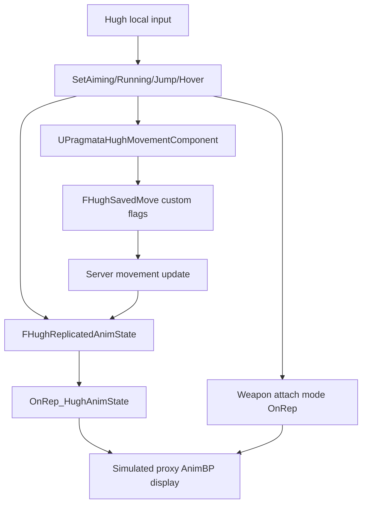
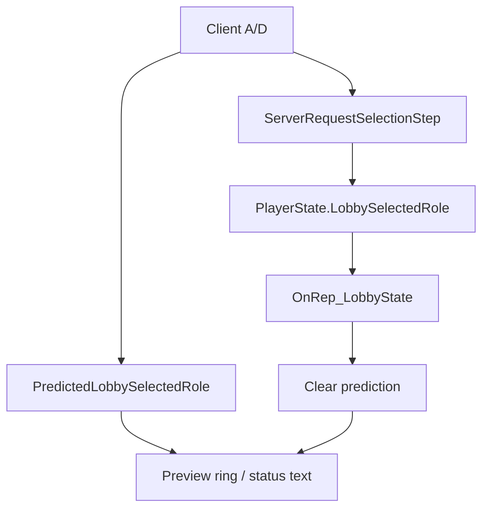

# Replication Role Animation Fix

## 목적

listen server 1명 + client 1명 PIE에서 Hugh/Diana 역할 선택 순서에 따라 spawn, possession, animation, lobby 선택 표시가 달라지던 문제 정리.

이 문서는 이번 branch에서 적용한 replication 수정의 기준 문서다.
코드 위치, 증상, 원인, 수정 계약, 검증 방법을 한 번에 찾기 위한 기록이다.

## 최종 결정

- gameplay spawn은 최종 `AssignedRole`만 기준으로 판단
- lobby 선택값, handoff, URL fallback은 `APragmataGameMode::EnsureAssignedRoleForController()` 내부에서만 소비
- Hugh 입력 intent는 `UPragmataHughMovementComponent` custom movement prediction으로 서버에 전달
- Hugh animation display state는 `FHughReplicatedAnimState`로 원격 `simulated proxy`에 전달
- weapon actor와 attach mode는 서버 확정 상태로 복제
- lobby character selection은 서버 확정값을 유지하되 owning client에만 예측 표시
- Host/Join 전에 local character preselect를 먼저 수행
- `AssignedRole`과 `ActiveControlRole`을 분리해 향후 일시 조작권 교환 준비
- 기존 local-only bool을 AnimBP 표시 기준으로 직접 쓰지 않고 predicted/replicated 상태를 경유

## 재현 증상

### Host Diana / Client Hugh

- host가 Diana 선택 시 host가 PlayerStart 위치에 고정
- host camera 회전과 이동 입력 불가
- joined Hugh 이동 시 walk/run animation이 host 화면에서 깨짐

관찰 의미:

- Diana role이 gameplay pawn possession까지 안정적으로 이어지지 않음
- Hugh movement intent가 서버 또는 listen-server view에서 animation state로 재구성되지 않음

### Host Hugh / Client Diana

- client Diana 화면에서 host Hugh의 지상 이동 animation은 비교적 정상
- Hugh aim 중이어야 할 때 client 화면에서는 손이 내려감
- Hugh hover 중이어야 할 때 client 화면에서는 공중에서 running pose 재생

관찰 의미:

- 위치 이동 replication은 동작
- aim/hover/run 같은 animation-driving state는 원격 클라이언트에 충분히 복제되지 않음
- weapon attach와 waist-arm pose가 local owner 쪽 상태에 묶임

### Match Lobby

- host는 A/D 선택이 즉시 보임
- joined client는 A/D 선택 표시가 약 1초 늦게 보임

관찰 의미:

- lobby 선택은 서버 확정값만 UI에 표시
- owning client local prediction 표시가 없음

### Host Hugh / Client Diana 정상, Host Diana / Client Hugh half-speed

- Host Hugh / Client Diana 조합은 양쪽 animation speed 정상
- Host Diana / Client Hugh 조합은 client Hugh 화면 정상
- 같은 조합의 listen server Diana 화면에서는 Hugh locomotion animation이 half-speed처럼 보임

관찰 의미:

- Hugh owner 쪽 prediction은 정상
- listen server가 보는 remote Hugh simulated proxy 표시값이 실제 proxy velocity/acceleration에 묶임
- AnimBP가 network smoothing/authority frame 차이로 낮게 보이는 속도를 읽으면 blend가 느린 pose를 선택

## 원인 정리

### Role spawn

기존 문제:

- gameplay spawn 경로가 `AssignedRole`, `LobbySelectedRole`, handoff, URL option을 여러 위치에서 직접 읽을 수 있었음
- `GetDefaultPawnClassForController()`가 최종 role 확정 전 상태를 볼 수 있었음
- role resolution 실패가 Diana pawn possession 실패 또는 Hugh fallback처럼 보일 수 있었음
- lobby에서 host가 Diana를 고르는 역순 조합에서 PlayerId, lobby index, ordered handoff 복구가 모두 필요

수정 원칙:

- role source 소비는 `EnsureAssignedRoleForController()`로 집중
- spawn/possess 이후 조회는 `AssignedRole`만 사용
- spawn 직전 role, pawn class, player id, lobby index를 로그로 확인 가능하게 유지
- `RegisterSpawnedPawnForRole()`에서 pawn pointer와 connected flag를 `GameState`에 같이 반영

핵심 코드:

- `Source/Pragmata_2P/Game/PragmataGameMode.cpp`
  - `ResolveGameplayRoleForController()`
  - `ResolveLobbyHandoffRoleForController()`
  - `EnsureAssignedRoleForController()`
  - `GetAssignedRoleForController()`
  - `GetDefaultPawnClassForController_Implementation()`
  - `RegisterSpawnedPawnForRole()`
- `Source/Pragmata_2P/Game/PragmataPlayerState.cpp`
  - `CopyProperties()`
  - `OverrideWith()`
  - `SetAssignedRole()`
  - `OnRep_LobbyState()`

## Hugh replication 계약

### 입력 intent

Hugh의 aim/run/hover/jump hold는 단순 animation bool이 아니다.
movement speed, movement mode, orientation, weapon attach, AnimBP state를 같이 바꾸는 gameplay state다.

따라서 일반 replicated bool만으로 처리하지 않고 movement prediction 경로를 사용한다.

새 타입:

- `Source/Pragmata_2P/Characters/PragmataHughMovementComponent.h`
- `Source/Pragmata_2P/Characters/PragmataHughMovementComponent.cpp`

역할:

- `SetWantsToAim()`
- `SetWantsToRun()`
- `SetWantsToHover()`
- `SetJumpInputHeld()`
- `FHughSavedMove::SetInitialPosition()`
- `FHughSavedMove::PrepMoveFor()`
- `FHughSavedMove::GetCompressedFlags()`
- `FHughSavedMove::CanCombineWith()`
- `UPragmataHughMovementComponent::UpdateFromCompressedFlags()`

custom flag 의미:

| Flag | 의미 |
| --- | --- |
| `FLAG_Custom_0` | aim intent |
| `FLAG_Custom_1` | run intent |
| `FLAG_Custom_2` | hover intent |
| `FLAG_Custom_3` | jump hold intent |

이 구조의 목적:

- owning client는 입력 즉시 예측 표시
- server는 movement update에서 같은 intent 복원
- replay/prediction 시 aim/run/hover 입력 전환 frame 보존
- 서로 다른 intent의 saved move는 합치지 않음
- `WantsTo*`는 입력 intent 전송용이고 animation/display 상태 원본이 아님

### Animation display state

새 타입:

- `FHughReplicatedAnimState`
- 위치: `Source/Pragmata_2P/Data/PragmataTypes.h`

복제 필드:

| Field | 목적 |
| --- | --- |
| `ActionState` | locomotion/combat/death 같은 상체 상태 표시 |
| `MovementState` | idle/walk/jog/run blend 기준 |
| `bIsAiming` | aim pose, orientation, weapon hand attach |
| `bIsRunning` | sprint animation과 MaxWalkSpeed intent |
| `bIsJumpInput` | jump hold와 hover 판정 공유 |
| `bIsHovering` | 공중 running pose 대신 hover loop 표시 |

소유 위치:

- `AHughCharacter::HughAnimState`
- `ReplicatedUsing=OnRep_HughAnimState`
- `DOREPLIFETIME_CONDITION(..., COND_SkipOwner)`로 owner local prediction 보호

갱신 경로:

```text
local input
  -> SetAimingState / SetRunningState / SetJumpInputState / SetHoveringState
  -> HughAnimState.bIs*
  -> UPragmataHughMovementComponent intent
  -> RefreshReplicatedAnimState
  -> server movement update
  -> replicated HughAnimState
  -> OnRep_HughAnimState
  -> ApplyReplicatedAnimState
```

원칙:

- owner와 server는 입력과 movement를 계산
- owner는 `HughAnimState`를 local prediction 상태로 직접 갱신하고 서버 snapshot을 받지 않음
- server는 movement compressed flag에서 intent를 복원해 자기 `HughAnimState`를 확정
- remote simulated proxy는 `HughAnimState` 복제값을 적용
- AnimBP의 aim/run/hover getter는 local-only bool이 아니라 `HughAnimState`를 읽음
- AnimBP locomotion `MovementSpeed`/`Acceleration`은 실제 `CharacterMovement` velocity/acceleration을 읽음
- `AHughCharacter`에 raw `IsAiming/IsRunning/IsJumpInput/IsHovering` 캐시를 두지 않음
- 이유: 입력 intent 기반 speed를 쓰면 키를 뗀 순간 AnimBP는 idle인데 capsule은 braking으로 계속 이동해 발 미끄러짐 발생

핵심 코드:

- `Source/Pragmata_2P/Characters/HughCharacter.cpp`
  - `SyncMovementIntentFromMovementComponent()`
  - `UpdateMovementState()`
  - `RefreshReplicatedAnimState()`
  - `ApplyReplicatedAnimState()`
  - `OnRep_HughAnimState()`
- `Source/Pragmata_2P/Animation/HughAnimInstance.cpp`
  - `NativeUpdateAnimation()`

### Half-speed 원인과 수정

원인:

- Host Diana / Client Hugh에서는 Hugh가 listen server 입장에서 remote client pawn
- AnimBP가 `GetVelocity().Size2D()`와 `GetCurrentAcceleration().Length()`를 직접 읽음
- remote proxy의 velocity/acceleration은 owner prediction 값과 frame/tick/smoothing 기준이 다름
- BlendSpace가 낮은 속도 또는 약한 acceleration을 읽으면 jog/run sample 사이를 느리게 선택
- 결과적으로 gameplay movement는 맞지만 listen server 화면의 Hugh animation만 half-speed처럼 보임

수정:

- `FHughReplicatedAnimState`는 aim/run/jump/hover 같은 상태 원본으로 유지
- `UHughAnimInstance::NativeUpdateAnimation()`의 `MovementSpeed`는 `GetMovementSpeed()` 사용
- `Acceleration`은 `GetCharacterMovement()->GetCurrentAcceleration().Length()` 사용
- display speed 기반 AnimBP 입력은 stop/braking feel을 깨뜨리므로 사용하지 않음

검증 기대값:

- Host Hugh / Client Diana: 기존처럼 정상 속도
- Host Diana / Client Hugh: remote 표시 속도는 실제 replicated movement 기준으로 확인
- Hugh hover: `bIsHovering` 우선, 공중 running pose 방지
- Hugh stop: 입력을 놓아도 capsule braking velocity가 남은 동안 AnimBP speed도 자연스럽게 감소

## Aim / Hover / Weapon

### Aim

문제:

- host Hugh 화면에서는 aim pose가 보임
- client Diana 화면에서는 Hugh가 손을 내린 상태

수정:

- `SetAimingState()`가 aim 관련 상태를 한 곳에서 변경
- aim 시작 시 run intent 해제
- `bOrientRotationToMovement`를 aim 상태에 맞춰 토글
- waist-arm state와 weapon attach mode를 함께 변경
- `HughAnimState.bIsAiming`으로 원격 proxy도 aim pose 적용

보존한 기존 의도:

- aim 중에는 이동 방향이 아니라 camera 방향으로 몸을 유지
- A/D 이동 시 몸은 조준 방향을 유지하고 좌우 이동
- aim 종료 시 이동 방향 회전으로 복귀

핵심 코드:

- `AHughCharacter::SetAimingState()`
- `AHughCharacter::ApplyReplicatedAnimState()`

### Hover

문제:

- host Hugh는 hover처럼 떠 있음
- client Diana 화면에서는 Hugh가 공중에서 running animation

수정:

- `SetHoveringState()`에서 hover 진입/이탈을 통합
- hover 시작 시 현재 Z를 `HoverTargetZ`로 저장
- movement mode를 `MOVE_Flying`으로 변경
- Z velocity를 `0`으로 초기화
- hover 종료 시 `MOVE_Falling`으로 복귀
- `HughAnimState.bIsHovering`으로 원격 proxy도 hover loop 선택

핵심 코드:

- `AHughCharacter::SetHoveringState()`
- `AHughCharacter::Landed()`
- `FHughReplicatedAnimState::bIsHovering`

### Weapon attach

문제:

- aim 상태에서 Hugh 손에 weapon이 붙어야 함
- non-owner 화면에서 weapon/waist-arm attach가 local 상태와 다를 수 있음

수정:

- `CurrentWeapon`은 서버에서만 spawn
- `AWeaponBase`는 `bReplicates=true`, movement replication enabled
- `EPragmataWeaponAttachMode` 추가
- `WeaponAttachMode`는 `ReplicatedUsing=OnRep_WeaponAttachMode`
- `CurrentWeapon`은 `ReplicatedUsing=OnRep_CurrentWeapon`
- attach logic은 `AttachWeaponToCurrentMode()`로 중앙화

attach mode:

| Mode | Attach target |
| --- | --- |
| `WaistArm` | `WaistArmComponent->GetWaistArmMesh()`의 `WeaponArmSocket` |
| `Hand` | Hugh mesh의 `WeaponSocket` |

핵심 코드:

- `AHughCharacter::PostInitializeComponents()`
- `AHughCharacter::SetWeaponAttachMode()`
- `AHughCharacter::AttachWeaponToCurrentMode()`
- `AHughCharacter::OnRep_CurrentWeapon()`
- `AHughCharacter::OnRep_WeaponAttachMode()`
- `Source/Pragmata_2P/Weapon/WeaponBase.cpp`

### Fire

수정:

- local owner는 montage를 즉시 재생
- server RPC가 combat state와 weapon 존재를 검증
- server가 `CurrentWeapon->PullTrigger()` 실행
- multicast가 non-owner에게 fire montage cosmetic 재생

핵심 코드:

- `AHughCharacter::OnStartAttack()`
- `AHughCharacter::Server_RequestFire_Implementation()`
- `AHughCharacter::Multicast_PlayFireMontage_Implementation()`

## Lobby selection prediction

문제:

- joined client가 A/D를 누른 뒤 선택 ring/status text가 서버 round-trip 후에만 변경
- host listen server는 local server라 지연이 거의 없음

수정:

- `APragmataLobbyPlayerController`가 owning client 전용 예측 선택값 보유
- 서버 RPC는 그대로 유지
- UI/preview는 local player 자신의 선택만 예측값 사용
- 다른 player 선택은 항상 `PlayerState` 서버 확정값 사용
- `APragmataPlayerState::OnLobbyStateChanged` delegate가 서버 확정 `OnRep` 도착 시 예측값 정리

핵심 코드:

- `Source/Pragmata_2P/Game/PragmataLobbyPlayerController.h`
  - `GetDisplayedLobbySelectedRole()`
  - `bHasPredictedLobbySelection`
  - `PredictedLobbySelectedRole`
- `Source/Pragmata_2P/Game/PragmataLobbyPlayerController.cpp`
  - `RequestLobbySelectionStep()`
  - `BindLobbyPlayerState()`
  - `HandleLobbyStateChanged()`
- `Source/Pragmata_2P/Game/PragmataPlayerState.h`
  - `OnLobbyStateChanged`
- `Source/Pragmata_2P/Lobby/LobbyCharacterPreviewActor.cpp`
  - `UpdateSelectionMarkers()`
- `Source/Pragmata_2P/UI/PragmataRoleLobbyWidget.cpp`
  - `BuildSelectionStatusText()`

### Role preselect

변경:

- title 이후 local preselect를 먼저 표시
- Host/Join 버튼은 local selected role이 있을 때만 표시
- Host/Join은 network action이며 gameplay role 뜻이 아님
- session travel URL은 `PreferredRole`을 lobby 초기 선택값으로만 전달
- 서버 lobby는 `LobbySelectedRole`을 확정하고 ready/start에서 충돌 검증
- gameplay map은 `AssignedRole` handoff만 사용

핵심 코드:

- `Source/Pragmata_2P/Game/PragmataSessionUtils.cpp`
  - `BuildLobbyListenTravelURL()`
  - `BuildLobbyJoinTravelURL()`
- `Source/Pragmata_2P/Game/PragmataMultiplayerSessionSubsystem.cpp`
  - `HostLobbySessionWithPreferredRole()`
  - `JoinLobbySessionByCodeWithPreferredRole()`
- `Source/Pragmata_2P/Game/PragmataLobbyGameMode.cpp`
  - `InitNewPlayer()`
  - `ParsePreferredRoleOption()`
  - `AssignLobbyDefaults()`
- `Source/Pragmata_2P/Game/PragmataLobbyPlayerController.cpp`
  - `IsLocalPreselectInputAllowed()`
  - `AdvanceLocalDisplayedRole()`
- `Source/Pragmata_2P/UI/PragmataRoleLobbyWidget.cpp`
  - `ResolveLocalPreferredRole()`
  - `RefreshLobbyView()`

### ActiveControlRole

목적:

- 추후 Hugh/Diana 일시 조작권 교환을 `AssignedRole` 변경 없이 처리
- spawn, handoff, team identity는 `AssignedRole` 고정
- input mapping, camera pitch, control affordance는 `ActiveControlRole` 기준으로 전환 가능

현재 구현:

- `APragmataPlayerState::ActiveControlRole` replicated
- `AssignedRole` 확정 시 기본값으로 `ActiveControlRole`도 같은 role 적용
- `APragmataPlayerController`는 input/camera 적용 시 `ActiveControlRole` 우선 사용
- 실제 pawn possession swap은 아직 하지 않음

표시 규칙:

| 대상 | 표시값 |
| --- | --- |
| local owning player | predicted value 우선 |
| remote player | replicated `PlayerState` value |
| server confirmation 도착 | prediction clear |

## Role handoff test

추가 검증:

- host Hugh / client Diana 기본 순서
- host Diana / client Hugh 역순
- player id 기반 handoff
- lobby index fallback
- ordered handoff queue
- seamless travel PlayerState copy

핵심 코드:

- `Source/Pragmata_2P/Game/PragmataSessionUtilsTests.cpp`
  - `FPragmataLobbyRoleHandoffTest`
  - `FPragmataLobbyPlayerStateCopyTest`

## 데이터 흐름





## 적용 파일

### Gameplay role

- `Source/Pragmata_2P/Game/PragmataGameMode.cpp`
- `Source/Pragmata_2P/Game/PragmataPlayerState.h`
- `Source/Pragmata_2P/Game/PragmataPlayerState.cpp`
- `Source/Pragmata_2P/Game/PragmataSessionUtilsTests.cpp`

### Hugh movement / animation

- `Source/Pragmata_2P/Data/PragmataTypes.h`
- `Source/Pragmata_2P/Characters/HughCharacter.h`
- `Source/Pragmata_2P/Characters/HughCharacter.cpp`
- `Source/Pragmata_2P/Characters/PragmataHughMovementComponent.h`
- `Source/Pragmata_2P/Characters/PragmataHughMovementComponent.cpp`
- `Source/Pragmata_2P/Characters/PlayableCharacter.h`
- `Source/Pragmata_2P/Characters/PlayableCharacter.cpp`

### Weapon / waist-arm

- `Source/Pragmata_2P/Characters/WaistArmComponent.cpp`
- `Source/Pragmata_2P/Weapon/WeaponBase.cpp`

### Lobby prediction

- `Source/Pragmata_2P/Game/PragmataLobbyPlayerController.h`
- `Source/Pragmata_2P/Game/PragmataLobbyPlayerController.cpp`
- `Source/Pragmata_2P/Lobby/LobbyCharacterPreviewActor.cpp`
- `Source/Pragmata_2P/UI/PragmataRoleLobbyWidget.cpp`

## 검증 결과

자동 검증:

- Editor target build 성공
- `Pragmata.Session` automation 성공
- 테스트 수: 4/4
- 이후 comment/directive pass에서 `git diff --check` 성공
- comment/directive pass는 C++ 동작 변경 없음

수동 PIE 확인 필요:

- listen server 1 + client 1
- host Hugh / client Diana
  - client 화면에서 Hugh aim pose 표시
  - Hugh weapon hand attach 표시
  - Hugh hover loop 표시
  - Hugh fire montage remote 표시
- host Diana / client Hugh
  - host가 Diana pawn possess
  - host camera turn, scan, hack input 동작
  - client Hugh movement가 host 화면에서 walk/jog/run과 일치
- lobby
  - client A/D 직후 ring과 status text 즉시 변경
  - 서버 확정값 도착 시 충돌/ready 상태 정정

## 재발 방지 규칙

- gameplay spawn code에서 `LobbySelectedRole`을 직접 fallback으로 읽지 않음
- role 확정은 `EnsureAssignedRoleForController()`에 집중
- role 없는 gameplay player를 Hugh로 fallback하지 않음
- animation-driving input은 단순 replicated bool보다 movement prediction 경로 우선 검토
- remote animation은 local-only field가 아니라 replicated display state를 기준으로 구성
- weapon attach는 socket attach call을 여러 input handler에 흩뜨리지 않음
- owning client UI prediction은 자기 표시만 바꿈
- remote player UI는 서버 확정 `PlayerState`만 표시

## 남은 주의점

- AnimBP graph 자체 state machine 오류는 C++ replication fix와 별개
- `FHughReplicatedAnimState` 값이 정상이어도 AnimBP transition 조건이 틀리면 pose는 깨질 수 있음
- Diana pawn camera/input 문제는 role spawn 실패와 input mapping 문제를 분리해서 확인 필요
- `CurrentWeapon` actor replication은 spawn class와 Blueprint default가 올바르게 설정돼야 함
- listen server에서는 host 화면이 server+owner라 client-only 문제를 가릴 수 있음
- 항상 host Hugh와 host Diana 양방향 PIE 조합을 모두 확인

## 빠른 디버그 포인트

### Host Diana가 PlayerStart에 고정

확인 순서:

1. `HandleStartingNewPlayer` 로그의 `AssignedRole`
2. 같은 로그의 `PawnClass`
3. `BP_PragGameMode`의 `DianaOperatorPawnClass`
4. `RegisterSpawnedPawnForRole` warning 여부
5. `GameState` Diana pawn pointer와 connected flag

### Client 화면에서 Hugh aim pose 누락

확인 순서:

1. `HughAnimState.bIsAiming` 복제 여부
2. `OnRep_HughAnimState()` 호출 여부
3. `ApplyReplicatedAnimState()`에서 waist-arm state와 weapon attach 적용 여부
4. AnimBP가 `GetIsAiming()` 또는 `ActionState`를 올바르게 읽는지 확인

### Client 화면에서 Hugh hover가 running pose

확인 순서:

1. `SetHoveringState(true)` 호출 여부
2. movement mode가 `MOVE_Flying`으로 바뀌는지 확인
3. `HughAnimState.bIsHovering` 복제 여부
4. Diana/Hugh AnimBP hover transition 조건 확인

### Lobby 선택 지연

확인 순서:

1. owning `APragmataLobbyPlayerController::RequestLobbySelectionStep()` 실행 여부
2. `bHasPredictedLobbySelection` 값
3. `GetDisplayedLobbySelectedRole()` 반환값
4. preview actor와 widget이 local player만 predicted value를 쓰는지 확인
5. `OnRep_LobbyState()` 후 prediction clear 여부
