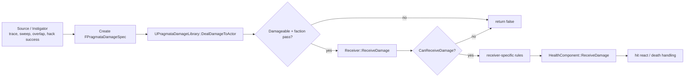
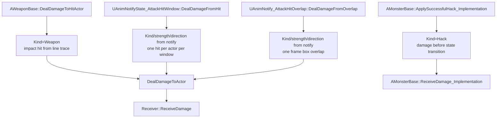
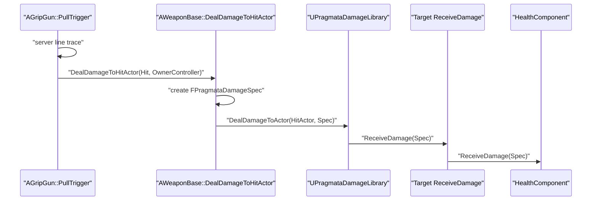
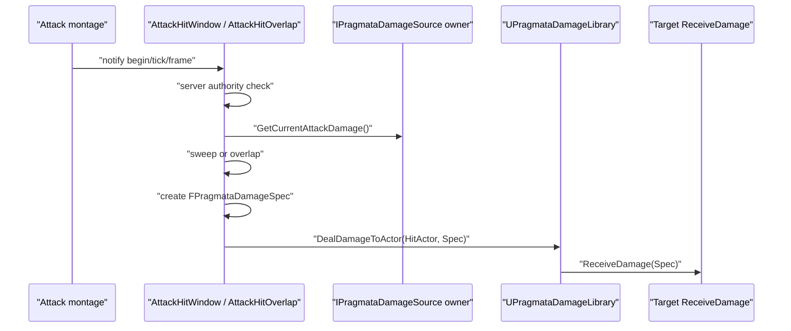
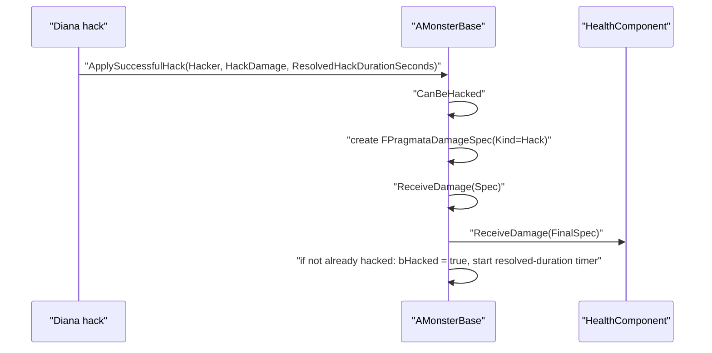
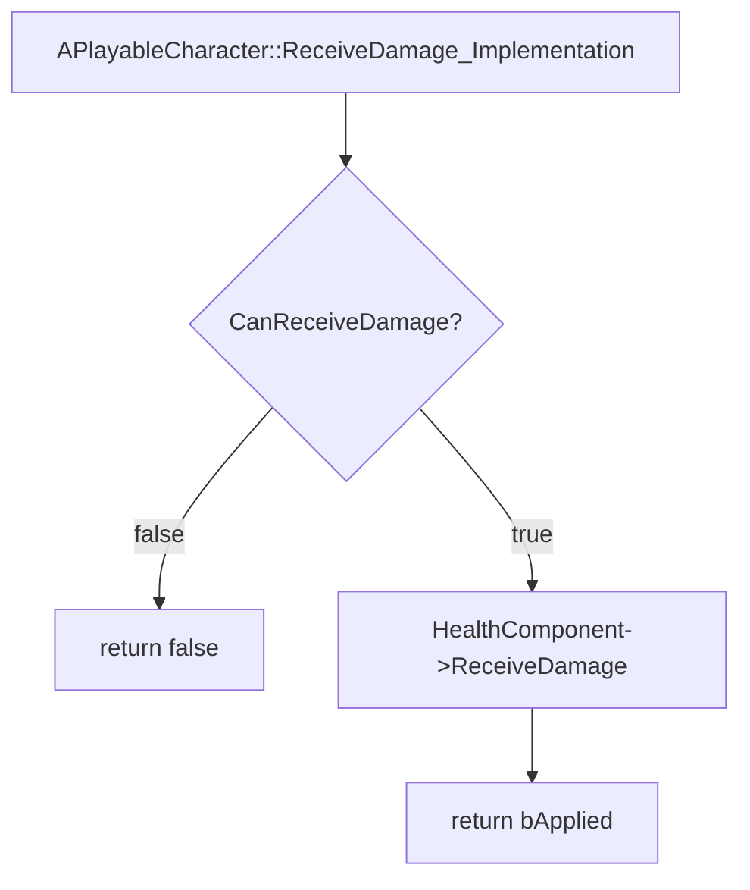
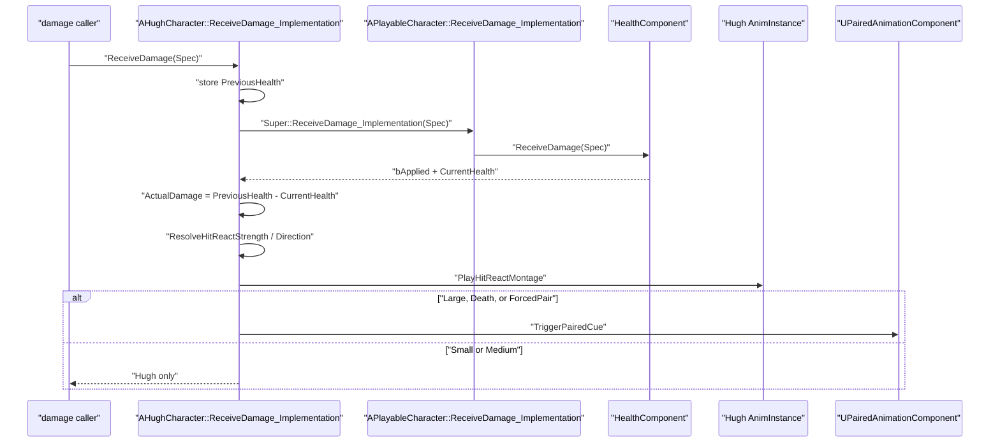
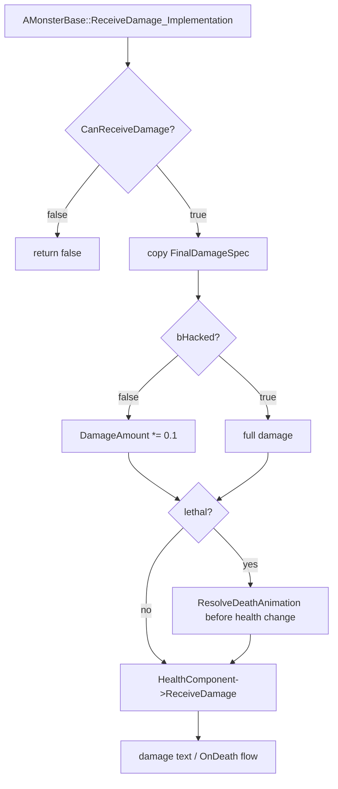

# Damage Flow

프로젝트 damage는 하나의 주 경로만 사용한다.

```text
FPragmataDamageSpec
-> UPragmataDamageLibrary::DealDamageToActor
-> IPragmataDamageable::ReceiveDamage
-> UPragmataHealthComponent::ReceiveDamage
```

Unreal `ApplyDamage`, `ApplyPointDamage`, `ApplyRadialDamage`는 gameplay damage 경로로 사용하지 않는다. 피해 source가 직접 `FPragmataDamageSpec`을 만들고, receiver는 `ReceiveDamage`에서 실제 적용 결과를 보고 반응한다.

## Naming Rules

- `Deal*`: caller/source가 target에게 damage 전달
- `Receive*`: target/receiver가 damage 수신
- `FPragmataDamageSpec`: source가 만든 damage 요청서
- `UPragmataHealthComponent::ReceiveDamage`: 최종 health mutation 지점
- `HitReact`: Hugh가 직접 재생하는 피격 반응
- `PairedCue`: Diana 동기화/잠금이 필요한 큰 피격 반응

## Core Contract

`FPragmataDamageSpec`은 damage source에서 생성한다.

- `DamageAmount`: 최종 체력 차감 요청량
- `SourceActor`: 피해를 시작한 actor. 예: Hugh, monster, Diana hacker
- `DamageCauser`: 실제 판정/무기/projectile actor. 예: `AGripGun`, melee owner
- `InstigatorController`: kill credit, AI 반응, 소유자 판정용 controller
- `DamageKind`: `Generic`, `Weapon`, `Hack`, `Melee`
- `HitReactStrength`, `HitDirection`: receiver 연출 선택값
- `bHasImpact`, `ImpactHit`, `ImpactDirection`: point/sweep/overlap 피해 위치와 방향

`IPragmataDamageable`은 receiver 계약만 가진다.

- `CanReceiveDamage`: 죽음/무효 damage 차단
- `ReceiveDamage`: actor별 규칙을 적용하고 health component로 전달

`UPragmataDamageLibrary::DealDamageToActor`는 전달 gate다.

- target이 `IPragmataDamageable`인지 확인
- source/target 양쪽에 `UPragmataFactionComponent`가 있으면 enemy faction만 통과
- 통과 시 `IPragmataDamageable::ReceiveDamage` 호출

## Source And Receiver Responsibilities



Source 책임:

- target 탐색: trace, sweep, overlap, hack target 확정
- `FPragmataDamageSpec` 생성
- amount, kind, instigator, causer, impact 정보 기록
- `DealDamageToActor(Target, Spec)` 호출

Receiver 책임:

- dead/invalid damage 차단
- actor별 방어, 감소, 사망 animation 선택
- health 차감 성공 여부 확인
- 실제 damage가 적용된 뒤 hit react/death cue 처리

Health component 책임:

- health 값 변경
- death 상태 확정
- health/death delegate broadcast
- animation, faction, source별 규칙은 넣지 않음

## Where FPragmataDamageSpec Is Generated



### Gun



`AWeaponBase::DealDamageToHitActor`가 `BaseDamage * PlayerDamageMultiplier`를 계산하고 `DamageKind=Weapon`, `SourceActor=GetOwner()`, `DamageCauser=this`, `InstigatorController=OwnerController`, impact 정보를 채운다.

### Melee And Critical



- `UAnimNotifyState_AttackHitWindow::DealDamageFromHit`: 휘두르는 공격, socket sweep, window 안에서 actor별 1회
- `UAnimNotify_AttackHitOverlap::DealDamageFromOverlap`: 순간 범위 공격, socket box overlap, query 안에서 actor별 1회
- damage amount는 owner의 `IPragmataDamageSource::GetCurrentAttackDamage`
- strength/direction/kind는 notify 설정값이 spec에 들어간다

### Diana Hack



Hack damage는 `DamageKind=Hack`으로 `ReceiveDamage`에 들어가므로 `AMonsterBase::ReceiveDamage_Implementation`의 hack 전 damage 10% 감소를 받지 않는다. 이미 hacked 상태에서 repeat 완료한 경우도 damage는 적용하지만 기존 `bHacked` timer는 reset하지 않는다.

## Receiver Details

### Playable Character Base



`APlayableCharacter`는 health 처리만 담당한다. HitReact는 하위 class가 실제 적용 성공 후 처리한다.

### Hugh HitReact



Trigger 조건:

- `Super::ReceiveDamage_Implementation(DamageSpec)`가 `true`
- 실제 health 감소량이 strength 계산에 사용됨
- `Small <= 0.04`, `Medium <= 0.10`, `Large > 0.10`
- `DamageSpec.HitReactStrength == ForcedPair`이면 paired cue를 강제
- death면 strength를 `Death`로 강제

Hugh와 Diana 분리:

- Hugh montage는 Hugh가 직접 재생한다.
- `Small`, `Medium`은 Diana cue/lock 없이 Hugh만 반응한다.
- `Large`, `Death`, `ForcedPair`만 `UPairedAnimationComponent`로 Diana 동기화/잠금 cue를 보낸다.

### Monster Receiver



Monster는 죽기 전에 `DamageSpec`을 보고 `CurrentDeathAnimation`을 먼저 확정한다. 이후 `HealthComponent::ReceiveDamage`가 `bIsDead`와 `OnDeath`를 확정하고, `SetDead`에서 AI, movement, attack montage, collision을 정리한다.

## Extension Rules

- 새 gameplay damage source는 source 쪽에서 `FPragmataDamageSpec`을 만들고 `DealDamageToActor`를 호출한다.
- Blueprint damage가 필요해도 Unreal `Apply Damage` 노드가 아니라 프로젝트 damage 함수/인터페이스를 사용한다.
- receiver animation은 health 적용 성공 이후 receiver class에서 처리한다.
- `UPragmataHealthComponent`에는 animation, faction, source-specific rule을 넣지 않는다.
- Monster hit react를 추가한다면 `AMonsterBase::ReceiveDamage_Implementation`에서 `bApplied && ActualDamage > 0.f` 이후가 적절하다.
