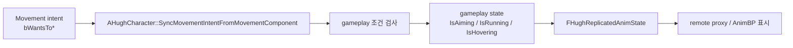
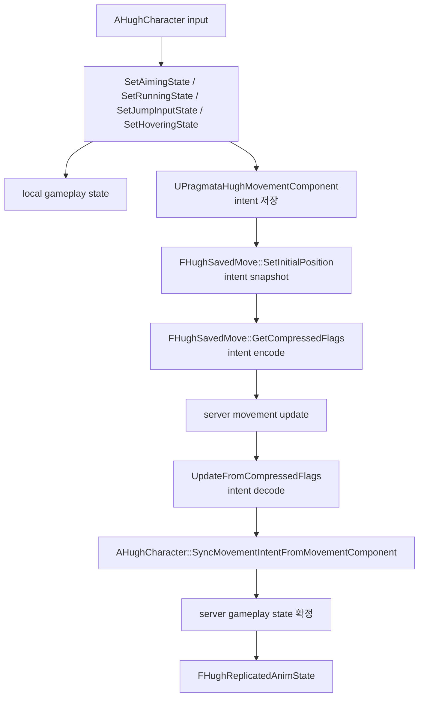

# Hugh Movement Component Guide

대상 파일:

- `Source/Pragmata_2P/Characters/PragmataHughMovementComponent.h`
- `Source/Pragmata_2P/Characters/PragmataHughMovementComponent.cpp`

## 한 줄 결론

`UPragmataHughMovementComponent`는 Hugh의 실제 이동 로직 전체가 아니라, `aim/run/hover/jump hold` 입력 intent를 Unreal CharacterMovement prediction 경로에 싣는 전용 component다.

## 왜 필요한가

Hugh의 `aim`, `run`, `hover`, `jump hold`는 단순 animation bool이 아니다.

- `aim`: 회전 방식, weapon attach, waist arm, combat pose 변경
- `run`: `MaxWalkSpeed`, run animation, stamina와 연결
- `hover`: `MOVE_Flying`, Z velocity, hover animation과 연결
- `jump hold`: hover 진입 판정과 공유

이 값들은 client 입력 직후 반응해야 하고, server movement update에서도 같은 frame의 intent로 재현되어야 한다. 그래서 일반 replicated bool만 쓰지 않고 `FSavedMove_Character`의 compressed flag 경로를 사용한다.

## Intent와 State 관계

핵심 구분:

- `intent`: 플레이어가 지금 하려고 한 입력 의도
- `state`: 게임이 그 intent를 받아들인 뒤 확정한 현재 상태

`UPragmataHughMovementComponent`는 `intent`만 운반한다. `state`를 최종 결정하지 않는다.

| 구분 | 예시 변수 | 소유 위치 | 의미 |
| --- | --- | --- | --- |
| 입력 intent | `bWantsToAim`, `bWantsToRun`, `bWantsToHover`, `bJumpInputHeld` | `UPragmataHughMovementComponent` | client가 보낸 요청 |
| saved intent | `bSavedWantsToAim`, `bSavedWantsToRun`, `bSavedWantsToHover`, `bSavedJumpInputHeld` | `FHughSavedMove` | 특정 movement sample의 요청 snapshot |
| gameplay state | `IsAiming`, `IsRunning`, `IsHovering`, `IsJumpInput` | `AHughCharacter` | 실제 gameplay 판단에 쓰는 현재 상태 |
| replicated display state | `FHughReplicatedAnimState` | `AHughCharacter` | remote proxy와 AnimBP 표시용 상태 |

### 규칙

- intent는 “요청”이다.
- state는 “승인된 결과”다.
- intent는 movement prediction을 타고 server로 간다.
- state는 `AHughCharacter`에서 gameplay 조건을 검사한 뒤 바뀐다.
- remote proxy는 intent를 직접 믿지 않고 replicated display state를 읽는다.

예시:

```text
Run key down
-> bWantsToRun = true
-> movement compressed flag 전송
-> server UpdateFromCompressedFlags
-> SyncMovementIntentFromMovementComponent
-> SetRunningState(true)
-> 조준 중이면 IsRunning=false 유지
-> RefreshReplicatedAnimState
```

이 예시에서 `bWantsToRun=true`는 요청일 뿐이다. `SetRunningState`가 `!bIsAiming` 조건을 통과해야 `IsRunning=true` state가 된다.

### Intent가 State로 바뀌는 지점



중요 위치:

- `UPragmataHughMovementComponent::UpdateFromCompressedFlags`
  - server movement update에서 intent 복원
- `AHughCharacter::SyncMovementIntentFromMovementComponent`
  - 복원된 intent를 읽고 state setter 호출
- `AHughCharacter::SetAimingState`
  - aim state 확정, run intent 정리 가능
- `AHughCharacter::SetRunningState`
  - aim 중이면 run state 거부
- `AHughCharacter::SetHoveringState`
  - movement mode와 hover state 확정
- `AHughCharacter::RefreshReplicatedAnimState`
  - state를 remote display용 snapshot으로 복제

### 왜 intent와 state를 분리하는가

분리하지 않으면 다음 문제가 생긴다.

| 문제 | 원인 |
| --- | --- |
| client는 run을 눌렀지만 server 화면은 jog 표시 | intent가 server movement update에 실리지 않음 |
| correction 후 aim/run pose가 튐 | saved move replay에 당시 intent가 복원되지 않음 |
| 조준 중 run이 켜짐 | 요청과 승인 state를 구분하지 않음 |
| remote proxy animation이 owner와 다름 | proxy가 replicated display state 대신 local prediction 값을 읽음 |

따라서 이 파일은 intent 운반만 맡고, state 확정은 `AHughCharacter`로 남긴다.

## 파일 역할

| 타입 | 위치 | 역할 |
| --- | --- | --- |
| `UPragmataHughMovementComponent` | `.h/.cpp` | 현재 Hugh 입력 intent 보관, compressed flag decode |
| `FHughSavedMove` | `.h/.cpp` | movement sample마다 Hugh intent snapshot 저장 |
| `FHughNetworkPredictionData_Client` | `.h/.cpp` | CharacterMovement가 `FHughSavedMove`를 만들도록 factory 교체 |

## 전체 흐름



## Custom Flag Map

| Flag | 저장 값 | setter | getter |
| --- | --- | --- | --- |
| `FLAG_Custom_0` | aim intent | `SetWantsToAim` | `WantsToAim` |
| `FLAG_Custom_1` | run intent | `SetWantsToRun` | `WantsToRun` |
| `FLAG_Custom_2` | hover intent | `SetWantsToHover` | `WantsToHover` |
| `FLAG_Custom_3` | jump hold intent | `SetJumpInputHeld` | `IsJumpInputHeld` |

주의:

- Unreal `FSavedMove_Character`의 custom flag는 수가 제한적
- 새 intent를 추가하려면 남은 flag 예산부터 확인
- flag 의미를 바꾸면 client/server prediction 호환이 깨질 수 있음

## 함수별 읽는 순서

### 1. `UPragmataHughMovementComponent::UPragmataHughMovementComponent`

초기 intent 값을 모두 `false`로 시작.

```cpp
bWantsToAim = false;
bWantsToRun = false;
bWantsToHover = false;
bJumpInputHeld = false;
```

의미:

- 첫 saved move가 쓰레기 bit를 갖지 않게 초기화
- default movement state를 명확히 고정

### 2. `SetWantsToAim`, `SetWantsToRun`, `SetWantsToHover`, `SetJumpInputHeld`

`AHughCharacter`가 입력 상태를 바꿀 때 호출하는 얇은 setter.

```cpp
void UPragmataHughMovementComponent::SetWantsToRun(bool bNewWantsToRun)
{
	bWantsToRun = bNewWantsToRun;
}
```

의미:

- 여기서 montage 재생, speed 변경, stamina 처리 금지
- 이 component는 intent 저장만 담당
- 실제 gameplay state 반영은 `AHughCharacter`가 담당
- setter 이름이 `SetWantsTo*`인 이유는 state 확정이 아니라 요청 저장이기 때문

### 3. `GetPredictionData_Client`

Unreal CharacterMovement prediction이 Hugh 전용 saved move를 쓰게 연결.

```cpp
MutableThis->ClientPredictionData = new FHughNetworkPredictionData_Client(*this);
```

의미:

- client prediction buffer 생성 지점 교체
- 이 함수가 없으면 `FHughSavedMove`가 생성되지 않음
- 그러면 custom flag encode/decode 경로도 동작하지 않음

### 4. `FHughNetworkPredictionData_Client::AllocateNewMove`

새 movement sample마다 `FHughSavedMove` 생성.

```cpp
return FSavedMovePtr(new FHughSavedMove());
```

의미:

- Unreal 기본 `FSavedMove_Character` 대신 Hugh 전용 snapshot 공간 사용

### 5. `FHughSavedMove::SetInitialPosition`

movement sample 시작 시점의 Hugh intent를 saved move에 복사.

```cpp
bSavedWantsToAim = HughMovement->WantsToAim();
bSavedWantsToRun = HughMovement->WantsToRun();
bSavedWantsToHover = HughMovement->WantsToHover();
bSavedJumpInputHeld = HughMovement->IsJumpInputHeld();
```

의미:

- client가 입력한 그 frame의 intent 저장
- 나중에 server RPC flag 생성과 client replay에 같은 snapshot 사용

### 6. `FHughSavedMove::GetCompressedFlags`

저장된 intent snapshot을 Unreal movement RPC flag에 압축.

```cpp
if (bSavedWantsToAim)
{
	Result |= FLAG_Custom_0;
}
```

의미:

- client에서 server로 보낼 intent bit 구성
- 여기서 flag map이 바뀌면 `UpdateFromCompressedFlags`도 같이 바꿔야 함

### 7. `UPragmataHughMovementComponent::UpdateFromCompressedFlags`

server movement update에서 flag를 다시 intent bool로 복원.

```cpp
bWantsToAim = (Flags & FSavedMove_Character::FLAG_Custom_0) != 0;
bWantsToRun = (Flags & FSavedMove_Character::FLAG_Custom_1) != 0;
bWantsToHover = (Flags & FSavedMove_Character::FLAG_Custom_2) != 0;
bJumpInputHeld = (Flags & FSavedMove_Character::FLAG_Custom_3) != 0;
```

의미:

- server가 client와 같은 movement intent를 알게 되는 지점
- 이 함수 자체는 Hugh gameplay state를 바꾸지 않음
- `AHughCharacter::SyncMovementIntentFromMovementComponent`가 복원된 intent를 읽어 state를 확정
- decode 직후 값은 아직 승인된 state가 아니라 server가 받은 요청

### 8. `FHughSavedMove::PrepMoveFor`

client replay 전에 saved move의 intent를 movement component에 복원.

```cpp
HughMovement->SetWantsToAim(bSavedWantsToAim);
HughMovement->SetWantsToRun(bSavedWantsToRun);
HughMovement->SetWantsToHover(bSavedWantsToHover);
HughMovement->SetJumpInputHeld(bSavedJumpInputHeld);
```

의미:

- correction/replay 중에도 입력 전환 frame 보존
- 예측 재생 시 현재 입력값이 아니라 당시 saved move 값을 사용

### 9. `FHughSavedMove::CanCombineWith`

서로 다른 intent를 가진 saved move는 합치지 않음.

```cpp
if (bSavedWantsToAim != NewHughMove->bSavedWantsToAim
	|| bSavedWantsToRun != NewHughMove->bSavedWantsToRun
	|| bSavedWantsToHover != NewHughMove->bSavedWantsToHover
	|| bSavedJumpInputHeld != NewHughMove->bSavedJumpInputHeld)
{
	return false;
}
```

의미:

- aim/run/hover/jump hold 전환 frame을 보존
- move combine으로 입력 변화가 뭉개지는 문제 방지
- 네트워크 비용은 조금 늘 수 있지만 animation/gameplay state 정확도가 우선

## `AHughCharacter`와의 연결

`AHughCharacter` 생성자에서 기본 movement component class를 교체한다.

```cpp
AHughCharacter::AHughCharacter(const FObjectInitializer& ObjectInitializer)
	: Super(ObjectInitializer.SetDefaultSubobjectClass<UPragmataHughMovementComponent>(ACharacter::CharacterMovementComponentName))
{
}
```

입력 state 변경 함수는 movement component setter를 호출한다.

| `AHughCharacter` 함수 | state 처리 | movement component intent |
| --- | --- | --- |
| `SetAimingState` | `IsAiming`, rotation, arm/weapon 상태 변경 | `SetWantsToAim` |
| `SetRunningState` | `IsRunning` 확정. aim 중이면 거부 | `SetWantsToRun` |
| `SetJumpInputState` | `IsJumpInput` 확정 | `SetJumpInputHeld` |
| `SetHoveringState` | `IsHovering`, `MovementMode` 확정 | `SetWantsToHover` |

server 또는 local owner는 `SyncMovementIntentFromMovementComponent`에서 복원된 intent를 읽는다.

```text
UPragmataHughMovementComponent intent
-> AHughCharacter::SyncMovementIntentFromMovementComponent
-> SetAimingState / SetRunningState / SetJumpInputState / SetHoveringState
-> RefreshReplicatedAnimState
```

읽는 기준:

- local owner는 input handler에서 state와 intent를 거의 동시에 갱신
- server는 movement flag decode 후 intent를 읽고 state를 재구성
- remote proxy는 movement component intent가 아니라 `FHughReplicatedAnimState`를 표시 source로 사용

## 이 파일에 넣으면 안 되는 것

- montage 재생
- stamina 차감
- weapon attach 변경
- waist arm 상태 변경
- AnimBP variable 직접 설정
- `MaxWalkSpeed` 직접 변경
- `SetMovementMode` 직접 호출

이유:

- 이 component는 prediction intent 운반 계층
- gameplay state는 `AHughCharacter`가 소유
- animation display state는 `FHughReplicatedAnimState`와 AnimInstance 쪽에서 처리

## 새 입력 intent 추가 절차

1. 남은 custom flag 여유 확인.
2. `UPragmataHughMovementComponent`에 `bWantsToX`, setter, getter 추가.
3. `FHughSavedMove`에 `bSavedWantsToX` 추가.
4. `Clear`에서 false 초기화.
5. `SetInitialPosition`에서 현재 intent 저장.
6. `PrepMoveFor`에서 replay용 intent 복원.
7. `GetCompressedFlags`에서 custom flag encode.
8. `UpdateFromCompressedFlags`에서 같은 flag decode.
9. `CanCombineWith`에서 intent 차이 비교.
10. `AHughCharacter::SyncMovementIntentFromMovementComponent`에서 gameplay state 반영.
11. listen server 2-player PIE로 owner/server/proxy 표시 확인.

## 흔한 실수

| 실수 | 결과 |
| --- | --- |
| setter에서 gameplay side effect 실행 | prediction replay 중 side effect 반복 위험 |
| intent 값을 곧바로 state로 취급 | 조준 중 run 같은 거부 조건이 무시됨 |
| `GetCompressedFlags`만 수정하고 `UpdateFromCompressedFlags` 누락 | server가 새 intent를 모름 |
| `CanCombineWith`에 새 intent 비교 누락 | 입력 전환 frame이 합쳐져 animation/state 지연 가능 |
| `PrepMoveFor` 복원 누락 | client correction 후 replay 상태가 현재 입력값에 오염 |
| flag 번호 재사용 | 기존 aim/run/hover/jump hold 의미 충돌 |
| remote proxy에서 이 component 값을 animation source로 직접 사용 | proxy는 owner 입력 prediction을 직접 갖지 않아 표시 불일치 |

## 검증 체크리스트

- Host Hugh / Client Diana PIE
  - Hugh aim 시작/종료가 host와 client 화면에서 같은 pose 전환
  - run 시작/종료가 listen server 화면에서도 run 표시와 속도 일치
  - jump hold 후 hover 진입/해제 표시 일치
- Client Hugh / Host Diana PIE
  - client Hugh 입력이 server movement update에서 반영
  - host 화면의 Hugh proxy가 aim/run/hover 표시 유지
- 네트워크 보정 상황
  - correction 후 aim/run/hover 입력 전환이 튀지 않음
  - 빠른 run tap, aim tap, jump hold/release가 누락되지 않음

## 관련 문서

- `Docs/Architecture/replication-role-animation-fix.md`
  - Hugh movement prediction과 replicated animation display state의 전체 설계
- `Docs/Systems/Server/server.md`
  - listen server 관점의 Hugh/Diana 역할, local prediction, server state 설명
- `Docs/Architecture/architecture.md`
  - Hugh movement prediction과 Diana avatar 구조의 큰 그림
