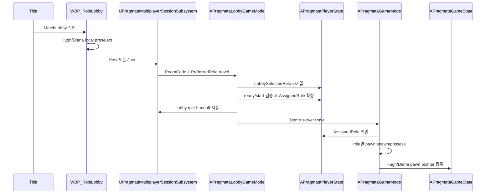

# Server Guide

`Pragmata_2P` 서버 코드 입문 문서.
listen server, lobby, role handoff, gameplay spawn, replication, RPC 작성 기준을 한 곳에 정리.

이 문서는 구조표가 아니라 작업 가이드다.
새 서버 코드를 쓰기 전 이 문서의 현재 상태와 금지선을 먼저 확인.
과거 분석, 개별 사고 기록, 증상별 처리 절차는 이 문서에 두지 않음.

## 먼저 잡을 모델

핵심 모델:

- Host/Join: network action
- Hugh/Diana: gameplay role
- listen server: 한 플레이어가 서버와 local client를 동시에 가짐
- client: 입력 의도 전송, 결과는 서버 복제 수신
- `GameMode`: 서버 전용 판정과 spawn
- `GameState`: 양쪽 화면이 봐야 할 match state 복제
- `PlayerState`: player별 role, ready, identity 복제
- `PlayerController`: local input/UI와 서버 RPC 출발점
- Pawn/Character: 실제 조작 대상과 gameplay component 보유

서버 작업의 기본 질문:

- 이 결정의 권한자는 누구인가?
- client가 보낸 값은 intent인가, 판정 결과인가?
- 다른 player가 봐야 하는 값은 어디로 복제되는가?
- listen server local 화면도 같은 delegate 경로를 타는가?
- Host Diana / Client Hugh 조합도 같은 방식으로 동작하는가?

구조를 이렇게 둔 이유:

- Host/Join과 Hugh/Diana를 분리해야 network 행동과 gameplay identity가 섞이지 않음
- listen server는 server와 local client가 한 프로세스에 공존하므로 `OnRep`만으로 UI 갱신을 보장할 수 없음
- 새 서버 코드는 client 편의보다 authoritative state 흐름을 먼저 맞춰야 함

## 전체 흐름

```text
Title
-> MatchLobby
-> local preselect
-> Host 또는 Join
-> room code session
-> lobby selected/ready
-> AssignedRole 확정
-> Demo server travel
-> role별 pawn spawn/possess
-> GameState pointer 복제
-> HUD/ViewModel bind
```



## 코드 위치

| 책임 | 주요 위치 |
| --- | --- |
| title 이후 map 흐름 | `UPragmataGameFlowConfig`, `UPragmataGameFlowSettings`, `APragmataTitlePlayerController` |
| session 생성/검색/room code | `UPragmataMultiplayerSessionSubsystem`, `PragmataSessionUtils` |
| lobby 선택/ready/start | `APragmataLobbyGameMode`, `APragmataLobbyGameState`, `APragmataLobbyPlayerController` |
| player role state | `APragmataPlayerState` |
| gameplay spawn | `APragmataGameMode` |
| match-wide replicated state | `APragmataGameState` |
| local input/HUD/RPC 출발점 | `APragmataPlayerController` |
| Hugh gameplay body | `AHughCharacter` |
| Diana camera/scan/hack operator | `ADianaOperatorPawn` |
| map/enemy puzzle 서버 권위 | `UDianaNodeInteractionComponent`, `UDianaHackComponent`, puzzle components |

## 바꾸기 전 체크

서버 코드 수정 전 확인:

- `AssignedRole`과 `ActiveControlRole` 중 어떤 state를 읽어야 하는지 확인
- `GameMode` 코드는 client에서 실행되지 않음을 전제로 작성
- `GameState` setter는 server local delegate와 `OnRep` 경로를 모두 고려
- client RPC parameter는 신뢰하지 말고 서버에서 다시 검증
- UI 표시용 state는 `PlayerController` 또는 HUD가 직접 계산하지 않고 복제 source에 bind
- role 없는 player를 Hugh로 조용히 fallback하지 않음
- `DefaultPawnClass`를 gameplay role spawn source로 되살리지 않음

## Role State

| State | Owner | Replicated | 용도 |
| --- | --- | --- | --- |
| `LobbySelectedRole` | server lobby | yes | lobby 선택 확정값 |
| `AssignedRole` | server lobby/gameplay | yes | spawn, team, identity 기준 |
| `ActiveControlRole` | server gameplay | yes | input/camera 기준, future swap 준비 |

규칙:

- local preselect는 제안값
- `PreferredRole`은 lobby 초기 선택값 전달용
- `LobbySelectedRole`은 lobby conflict/ready/start 판단용
- `AssignedRole`은 gameplay spawn의 authoritative source
- `ActiveControlRole`은 현재 조작 affordance 기준
- control swap을 추가해도 `AssignedRole`은 identity로 유지

이유:

- lobby 선택, gameplay identity, 현재 조작 주체를 한 enum으로 합치면 lobby handoff와 future control swap이 서로 영향을 줌
- `AssignedRole`은 spawn과 team identity의 기준이라 gameplay 중 쉽게 바뀌면 HUD, GameState pointer, pawn ownership 추적이 어려움
- `ActiveControlRole`을 따로 두면 v1에서는 input/camera만 전환하고, v2에서 실제 `Possess()` 교환을 검토 가능

역할 확정 흐름:

```text
local preselect
-> PreferredRole URL option
-> PlayerState.LobbySelectedRole
-> ready/start 검증
-> PlayerState.AssignedRole
-> lobby handoff 저장
-> Demo spawn
-> ActiveControlRole 기본값 설정
```

## Session Flow

Host:

```text
GenerateRoomCode
-> CreateSession
-> OpenLevel /Game/Map/MatchLobby with listen?RoomCode=<code>?PreferredRole=<role>
-> room code 표시
```

Join:

```text
NormalizeRoomCode
-> FindSessions retry
-> matching PragmataRoomCode 확인
-> <connect>?RoomCode=<code>?PreferredRole=<role>
```

Room code 규칙:

- alphabet: `ABCDEFGHJKLMNPQRSTUVWXYZ23456789`
- length: `6`
- 경우의 수: `32^6 = 1,073,741,824`
- 같은 code session이 2개 이상 검색되면 ambiguous 거부
- room code는 인증 수단이 아니라 LAN session 검색 키
- 공개 backend나 대규모 room에서는 host 생성 전 code 예약/재생성 필요

이유:

- 현재 범위는 LAN 학습/테스트라 account backend 없이 즉시 host/join 확인이 중요
- room code를 session setting에 싣는 방식은 UI와 travel URL을 단순하게 유지
- ambiguous session을 거부하면 같은 code가 검색되어도 자동 오접속으로 이어지지 않음
- packaged host는 최초 listen lobby 진입 때 `ServerTravel`을 쓰지 않음
- `OnlineSubsystemNull`은 LAN 응답 시 현재 listen `NetDriver` port를 광고하므로 host world가 실제 listen 상태여야 함
- client connect string이 `:0`이면 listen port 미준비 상태라 `ClientTravel` 전에 실패 처리

Session state는 `FPragmataSessionStatus`로 UI에 전달.
`Creating`, `Searching`, `Joining`은 busy state.

## Travel 계약

Lobby URL:

```text
/Game/Map/MatchLobby?listen?RoomCode=<code>?PreferredRole=<Hugh|Diana>
<connect>?RoomCode=<code>?PreferredRole=<Hugh|Diana>
```

Host 구현 주의:

- 최초 host 진입: `OpenLevel(Map, true, "listen?...")`
- 이미 lobby/game server인 상태의 map 이동: `ServerTravel`

Game URL:

```text
/Game/Map/Demo?game=/Game/Blueprints/BP_PragGameMode.BP_PragGameMode_C?RoomCode=<code>
```

URL option:

| Option | 위치 | 의미 |
| --- | --- | --- |
| `RoomCode` | lobby/game travel | session 식별, 입장 검증 |
| `PreferredRole` | lobby travel | local preselect 전달 |
| `PragmataRole` | legacy direct game travel | 명시 map smoke fallback |

금지:

- gameplay travel에 per-player role option 의존
- Demo에서 `LobbySelectedRole`만 보고 spawn 확정
- room code 있는 travel에서 role 미확정 player를 Hugh로 자동 대체

이유:

- Demo server travel은 player별 URL option을 안정적으로 들고 가지 않음
- lobby가 확정한 `AssignedRole`을 handoff해야 Host Diana / Client Hugh 조합도 같은 spawn 규칙을 통과
- silent Hugh fallback은 role handoff 누락을 숨겨 Diana possession 오류를 늦게 발견하게 만듦

## Lobby Server

`APragmataLobbyGameMode` 책임:

- `PreLogin`: room code, player count 검증
- `InitNewPlayer`: `PreferredRole`을 `LobbySelectedRole` 초기값으로 적용
- `PostLogin`: lobby index/default role 보강
- selection RPC 처리
- ready RPC 처리
- start 시 두 player, 서로 다른 role, ready 상태 재검증
- `AssignedRole` 확정
- session subsystem에 role handoff 저장
- Demo server travel

`APragmataLobbyGameState` 책임:

- `LobbyPhase`
- `RoomCode`
- `WarningMessage`
- start 가능 여부와 conflict 표시 상태

`APragmataLobbyPlayerController` 책임:

- local preselect/prediction
- lobby widget 표시
- selection/ready/start RPC 요청
- server state 도착 시 prediction 정리

UI 규칙:

- preselect 전 Host/Join/room code 입력 숨김
- preselect 후 session action 표시
- connected lobby에서는 server `PlayerState` 표시 우선
- 같은 role 선택은 표시 가능, ready/start에서 차단

이유:

- local preselect는 입력 반응성을 위한 prediction
- conflict 판단은 서버 lobby가 맡아야 두 player 화면의 선택 상태가 같음
- Host/Join 버튼은 network action이고 character 선택 버튼이 아니므로 UI 단계도 분리

## Gameplay Server

`APragmataGameMode` spawn 기준:

```text
HandleStartingNewPlayer
-> EnsureAssignedRoleForController
-> RestartPlayer
-> GetDefaultPawnClassForController
-> SpawnDefaultPawnAtTransform
-> RegisterSpawnedPawnForRole
```

Role source 우선순위:

1. `AssignedRole`
2. `LobbySelectedRole`
3. `APragmataPlayerController` cached role
4. lobby handoff by player id
5. lobby handoff by lobby index
6. ordered handoff queue
7. URL `PragmataRole`
8. code 없는 PIE/dev 자동 배정

Spawn 계약:

- Hugh role: `AHughCharacter`
- Diana role: `ADianaOperatorPawn`
- Demo는 단일 `PlayerStart` anchor 사용
- Diana는 right offset spawn
- `BP_PragGameMode.DefaultPawnClass=None`
- role class cast 성공 시 `APragmataGameState`에 pointer와 connected flag 등록

막아야 하는 fallback:

- `AssignedRole=None`
- role class 미지정
- wrong class cast
- room code 있는 travel에서 handoff 누락

이유:

- `DefaultPawnClass` fallback은 role별 spawn 계약을 우회
- `GameState`의 Hugh/Diana pointer는 HUD, shared stats, Diana anchor 로직의 source
- spawn 불가 상태를 early error로 드러내야 잘못된 lobby handoff와 class assignment를 바로 고칠 수 있음

## Hugh Server/Replication

Hugh는 physical gameplay body.
movement, weapon, damage, animation display의 중심.

핵심 구조:

- `AHughCharacter`: input intent, weapon attach, replicated anim state
- `UPragmataHughMovementComponent`: saved move custom flag
- `FHughReplicatedAnimState`: remote display용 작고 명시적인 state
- `UHughAnimInstance`: proxy velocity 대신 replicated display speed 사용

Custom movement flag:

| Flag | 의미 |
| --- | --- |
| `FLAG_Custom_0` | aim intent |
| `FLAG_Custom_1` | run intent |
| `FLAG_Custom_2` | hover intent |
| `FLAG_Custom_3` | jump hold intent |

Animation speed 기준:

| MovementState | Display speed |
| --- | --- |
| `Idle` | `0` |
| `Walk` | `150` |
| `Jog` | `300` |
| `Run` | `600` |
| `Hover` | `0`, hover state 우선 |

주의:

- listen server는 client Hugh를 simulated proxy로 봄
- proxy `Velocity`/`Acceleration`만으로 AnimBP blend 판단 금지
- owner prediction과 server display state를 분리
- weapon pointer는 replication 전 `nullptr` 가능
- 표시 계층에서 `CurrentWeapon` 직접 역참조 금지

이유:

- owner 화면은 local prediction을 보지만 listen server 화면은 remote proxy 표시값을 봄
- proxy movement 값은 network smoothing과 tick 차이로 owner와 다를 수 있음
- `FHughReplicatedAnimState`는 gameplay 판정보다 remote display 안정성을 위한 좁은 복제 state
- weapon actor는 server spawn 후 client 복제까지 정상적인 null 구간이 있음

## Diana Server/Replication

Diana player는 `ADianaOperatorPawn`을 possess.
Hugh 등에 붙은 Diana mesh는 표현용 avatar.

핵심 구조:

- `ADianaOperatorPawn`: local camera, aim, scan/hack input
- `UDianaScanComponent`: scan 요청과 결과
- `UDianaHackComponent`: enemy hack 요청/완료 처리
- `UDianaNodeInteractionComponent`: map puzzle focus/interaction
- `APragmataGameState`: active puzzle target과 Diana action lock 복제

서버 검증 원칙:

- client-sent camera origin/direction 직접 신뢰 금지
- 서버가 Hugh anchor와 저장된 Diana view rotation으로 trace 재계산
- scan/hack 요청은 reliable intent RPC
- Diana view rotation은 unreliable update 허용
- action lock, distance, LOS, interface, role 확인 필수

Diana 입력 의미:

| 입력 | 서버 의미 |
| --- | --- |
| look | local camera 회전, 서버 view rotation 갱신 |
| aim | replicated aiming state, hack focus 조건 |
| scan | 서버 scan 요청 |
| enemy reticle focus | enemy hack 요청 |
| map node focus | map hack 요청 |
| W/A/S/D, gamepad face | active puzzle 방향 입력 |
| aim release | active enemy/map hack cancel 요청 |

Host Diana 주의:

- listen server local 화면도 client처럼 input/UI를 가져야 함
- `OnRep`만 믿으면 server local HUD가 갱신되지 않을 수 있음
- `GameState` setter에서 local delegate broadcast 필요
- `AssignedRole=Diana`, `DianaOperatorPawnClass`, `ActiveControlRole` 순서 확인

이유:

- Diana는 Hugh body를 직접 possess하지 않으므로 camera/scan/hack 권한 경계가 더 민감
- client camera 값을 믿으면 화면 조작으로 서버 판정을 우회할 수 있음
- Hugh anchor와 server-stored view rotation을 쓰면 Diana client와 Hugh listen server 양쪽에서 같은 판정 기준을 유지
- unreliable view update와 reliable action RPC를 분리하면 잦은 look 입력이 gameplay 요청을 막지 않음

## Puzzle Server 기준

공통 규칙:

- Diana 입력은 client intent
- puzzle 진행은 server-authoritative component
- Hugh/Diana HUD는 같은 replicated puzzle state 표시
- active 대상은 `APragmataGameState`가 복제
- 같은 actor 재시작은 pointer 변화만으로 부족하면 serial 사용
- 완료 hold timer는 target 일치 확인 후 UI clear
- stale cancel/timer가 새 session을 닫지 않게 target 비교

Enemy hack:

- Diana aim 중 reticle target 기준
- Diana `OperatorMode`/combat state와 무관
- Hugh 기준 거리와 Diana camera LOS 검증
- 성공 시 damage와 OverDrive 증가 모두 서버 처리

Map hack:

- Diana `Roaming + non-combat + Aim` 전용
- `APuzzleInteractable::Interact_Implementation()`이 entrypoint
- actor에 `UMapHackingPuzzleComponent`가 있으면 map hack
- component가 없으면 기존 `CompletePuzzle()` 경로

Puzzle state source:

- enemy active target: `APragmataGameState::ActiveEnemyHackTarget`
- enemy 재시작 알림: `ActiveEnemyHackSerial`
- map active actor: `APragmataGameState::ActiveMapPuzzleActor`
- enemy model: `UEnemyHackingPuzzleComponent`
- map model: `UMapHackingPuzzleComponent`
- enemy server owner: `UDianaHackComponent`
- map server owner: `UDianaNodeInteractionComponent`

이유:

- puzzle component가 sequence와 진행도를 소유해야 HUD가 같은 replicated model을 읽음
- Diana component는 target 검증과 서버 입력 전달만 맡아 actor별 puzzle rule과 분리
- `GameState` active actor를 source로 두면 Hugh/Diana HUD가 같은 대상에 bind
- 같은 actor를 다시 hack할 때 pointer 값이 그대로라 serial이 별도 rebind 신호 역할

## HUD와 GameState

HUD 생성 책임:

- common `APragmataPlayerController`
- role pawn이나 Blueprint controller가 root HUD 중복 생성 금지
- Hugh root HUD: `WBP_HughHUD`
- Diana root HUD: `WBP_DianaHUD`
- class source: possessed pawn defaults의 `GameplayHUDClass`

공유 HUD state source:

- Hugh health/stamina: `APragmataGameState`의 Hugh pointer 기준
- Diana OverDrive: `APragmataGameState`의 Diana pointer 기준
- enemy hack UI: `ActiveEnemyHackTarget`
- map hack UI: `ActiveMapPuzzleActor`

Setter 규칙:

```text
server state 변경
-> GameState setter
-> server local delegate broadcast
-> replicated property
-> client OnRep
-> client delegate broadcast
-> PlayerController/HUD/ViewModel bind
```

이유:

- listen server local player는 `OnRep`가 안 불릴 수 있음
- remote client는 `OnRep` 경로 필요
- 양쪽 HUD가 같은 source를 보아야 함
- root HUD 생성을 controller에 모으면 Hugh/Diana pawn Blueprint가 UI를 중복 생성하지 않음
- class source를 pawn defaults에 두면 designer가 role별 WBP를 C++ 수정 없이 교체 가능

## RPC 작성 규칙

Server RPC에 넣어도 되는 것:

- 입력 의도
- enum 방향
- 후보 actor pointer
- client가 보고 있다고 주장하는 target
- expected target cancel 보호값

Server RPC에서 다시 확인할 것:

- controller/pawn owner
- role
- action lock
- current mode
- distance
- LOS
- interface 구현
- component 존재
- active target 일치

피할 것:

- client camera origin/direction으로 최종 판정
- client UI state를 gameplay source로 사용
- RPC 하나에서 UI 표시와 gameplay 판정을 동시에 결정
- stale cancel이 현재 active target을 닫는 구조

## 네 가지 필수 조합

| 조합 | 확인 |
| --- | --- |
| Host Hugh / Client Diana | Hugh movement, aim, hover, weapon, Diana scan/hack |
| Host Diana / Client Hugh | Diana local camera/input, listen server의 client Hugh animation speed |
| Host Hugh / Client Hugh 충돌 | 같은 role ready/start 차단 |
| Host Diana / Client Diana 충돌 | 같은 role ready/start 차단 |

추가 확인:

- Host/Join 어느 쪽이 Hugh여도 Hugh animation speed 동일
- Host/Join 어느 쪽이 Diana여도 Diana camera/input 동일
- role 없는 player는 spawn 차단 또는 명시 오류
- Hugh/Diana HUD가 같은 active puzzle state 표시

## 테스트

Automation:

```text
Pragmata.Session.RoomCode.NormalizeAndValidate
Pragmata.Session.TravelURL.RoleAndRoomCode
Pragmata.Session.Lobby.RoleHandoffStoresRoles
Pragmata.Session.Lobby.PlayerStateCopyPreservesRole
```

Build:

```text
Build.bat Pragmata_2PEditor Win64 Development -Project=Pragmata_2P.uproject -WaitMutex -NoHotReload
```

Automation command:

```text
UnrealEditor-Cmd.exe Pragmata_2P.uproject -Unattended -NullRHI -NoSplash -ExecCmds="Automation RunTests Pragmata.Session; Quit" -TestExit="Automation Test Queue Empty"
```

수동 PIE:

- 2-player listen server
- Host Hugh / Client Diana
- Host Diana / Client Hugh
- 같은 role 선택 충돌
- lobby ready/start
- Demo possession
- Hugh movement/aim/hover/weapon
- Diana camera/scan/enemy hack/map hack
- Hugh/Diana HUD 동기화

## 수정별 진입점

| 작업 | 먼저 볼 곳 |
| --- | --- |
| room code/session 로직 | `UPragmataMultiplayerSessionSubsystem`, `PragmataSessionUtils` |
| lobby 선택/ready 로직 | `APragmataLobbyGameMode`, `APragmataPlayerState` |
| Demo spawn/possession 로직 | `APragmataGameMode`, `APragmataGameState` |
| Hugh remote animation | `FHughReplicatedAnimState`, `UHughAnimInstance` |
| Diana camera/input | `ADianaOperatorPawn`, `APragmataPlayerController` |
| scan/hack 검증 | `UDianaScanComponent`, `UDianaHackComponent`, `UDianaNodeInteractionComponent` |
| enemy/map puzzle HUD | `APragmataGameState`, root HUD, ViewModel |
| title/lobby/game map 변경 | `UPragmataGameFlowConfig`, `Config/DefaultEngine.ini`, map WorldSettings |
